# 海拉 · Haila

把论文读薄，把思路读厚。左侧显示论文原始 PDF，右侧是一个读过全文、回答带页码的 AI 精读伙伴。

支持三种入口：**粘贴 arXiv 链接 / 编号**、**任意 PDF 直链**，或**拖入本地 PDF**；也可以把多个链接和文件一次批量导入。论文会自动进入本地文库，聊天记录按论文分组保存；在原文中划选文字即可自动翻译。

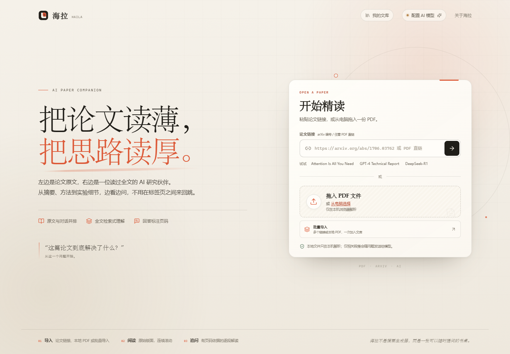

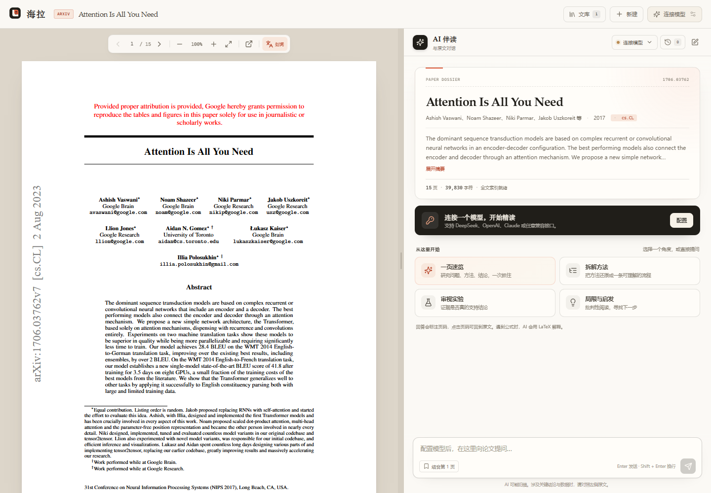

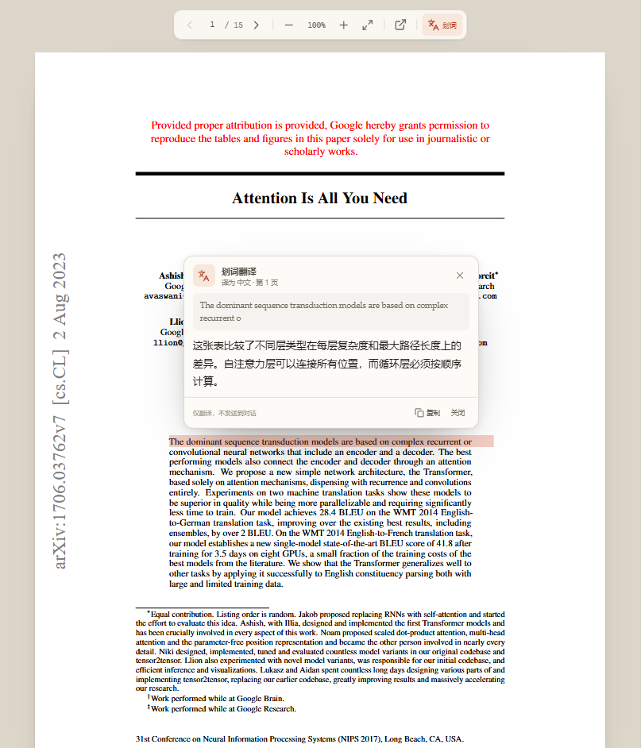

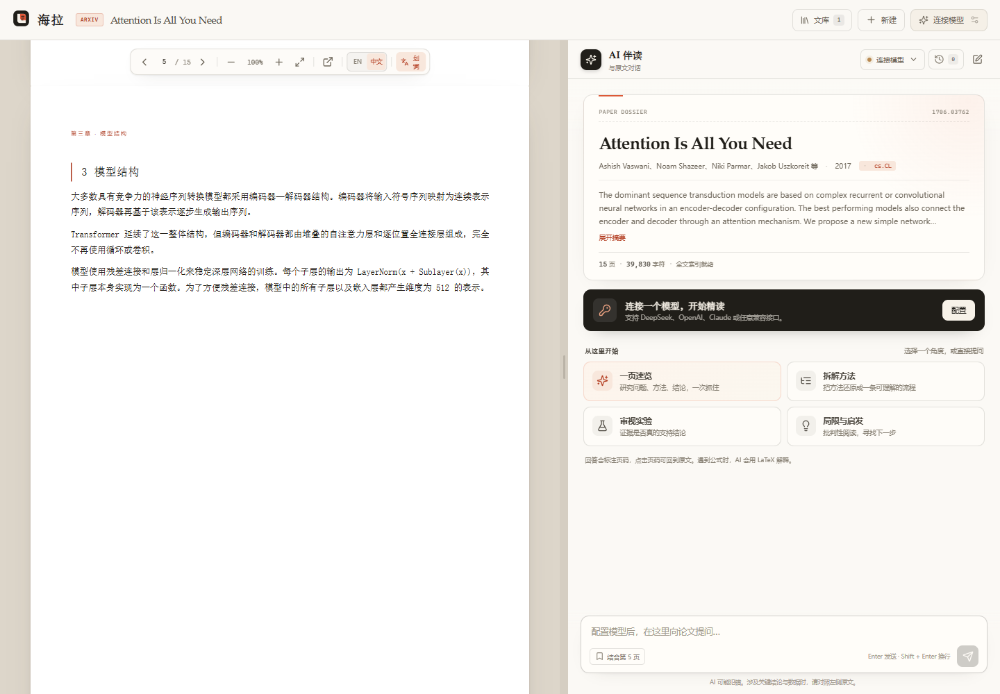

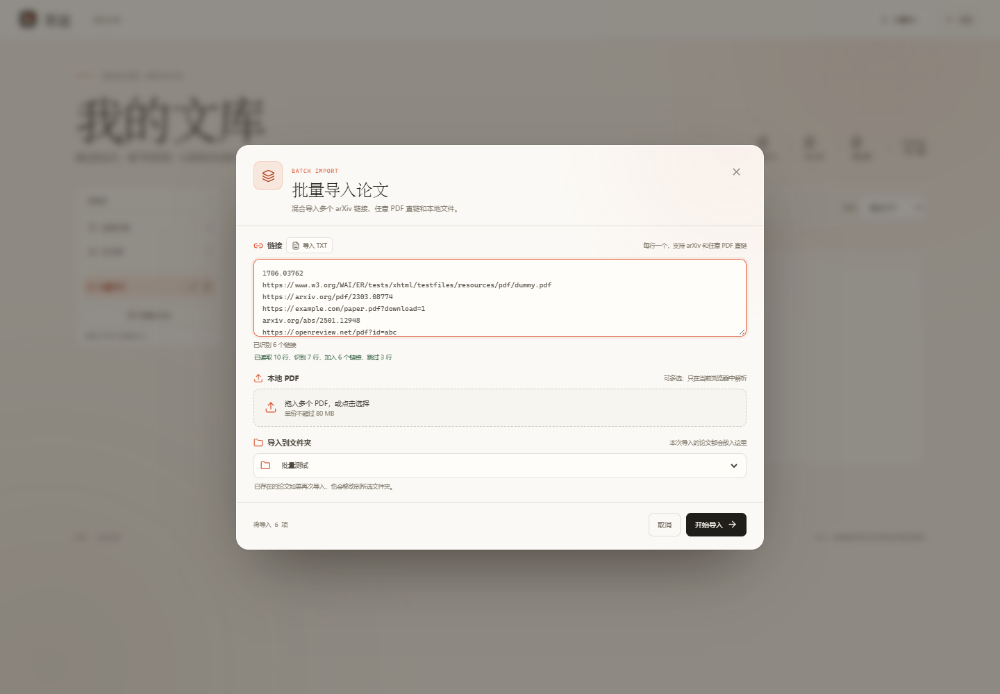

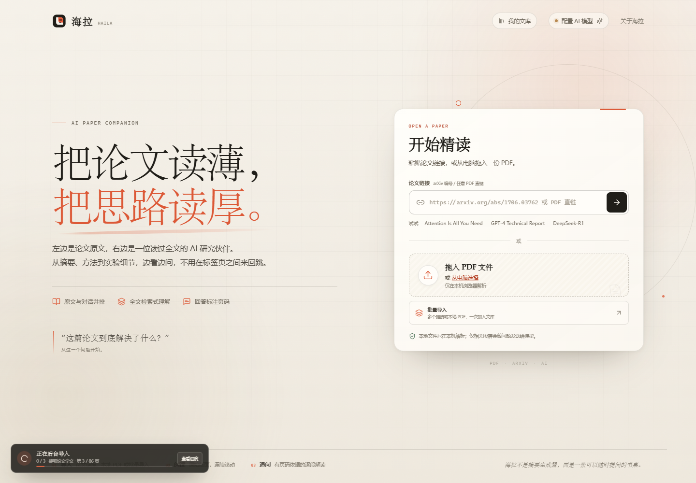

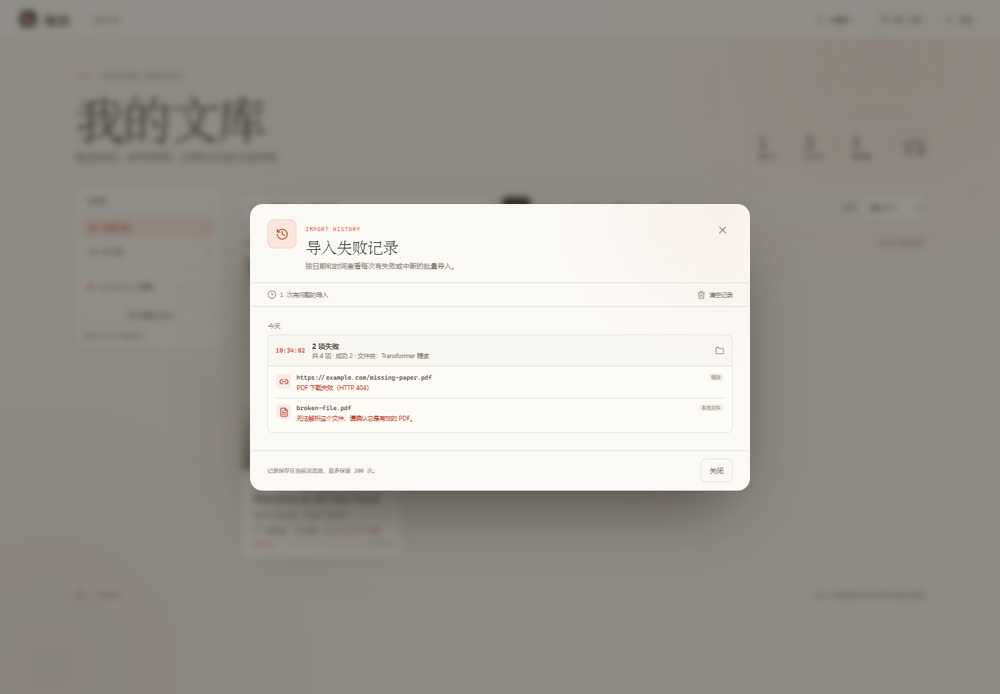

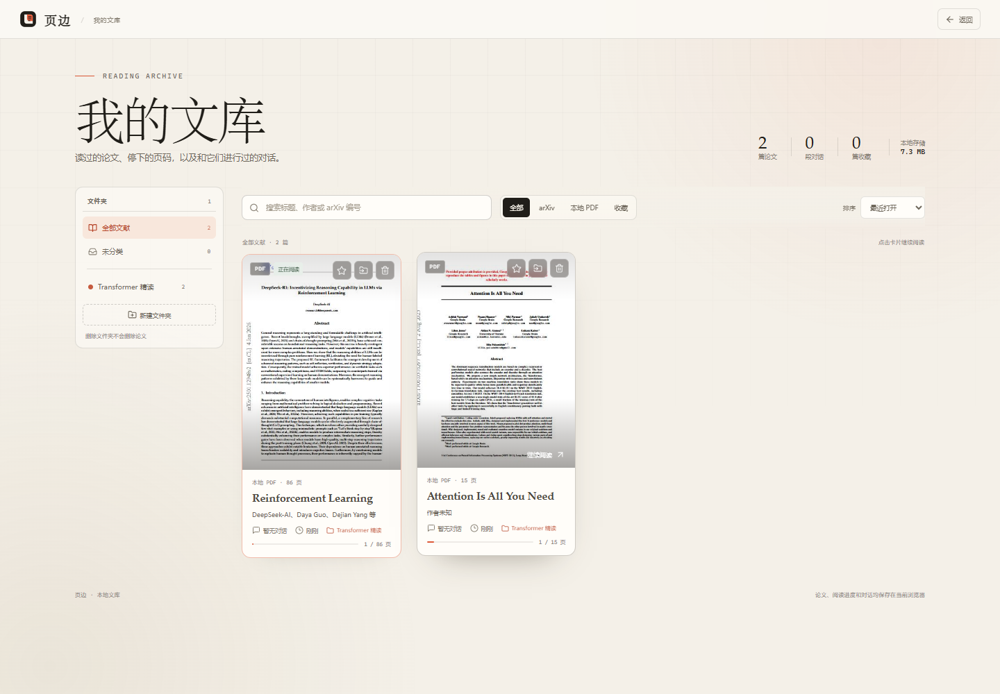

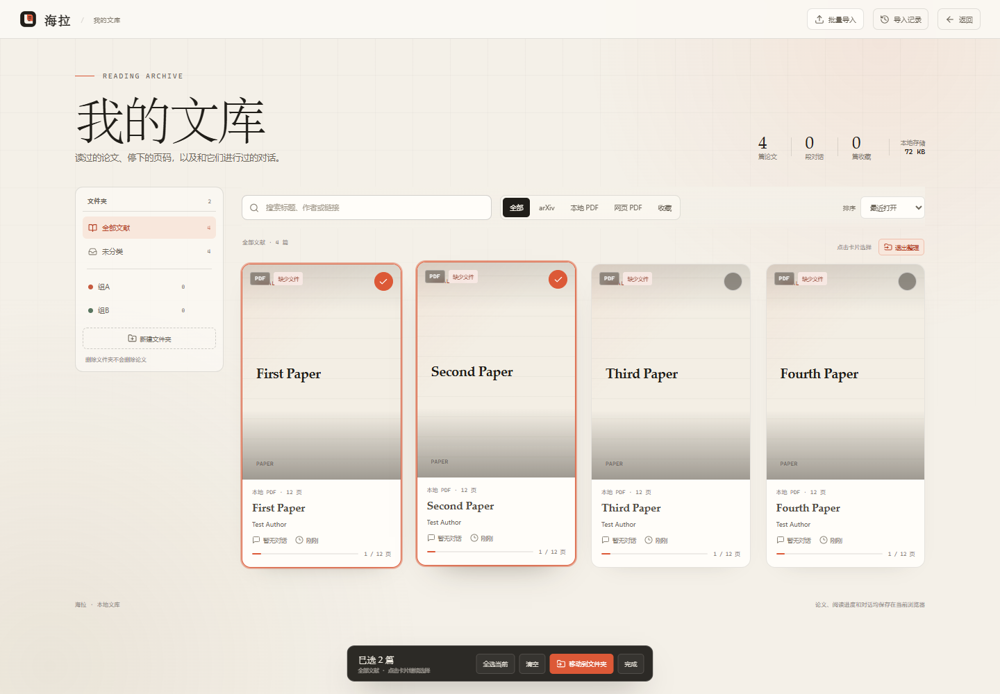

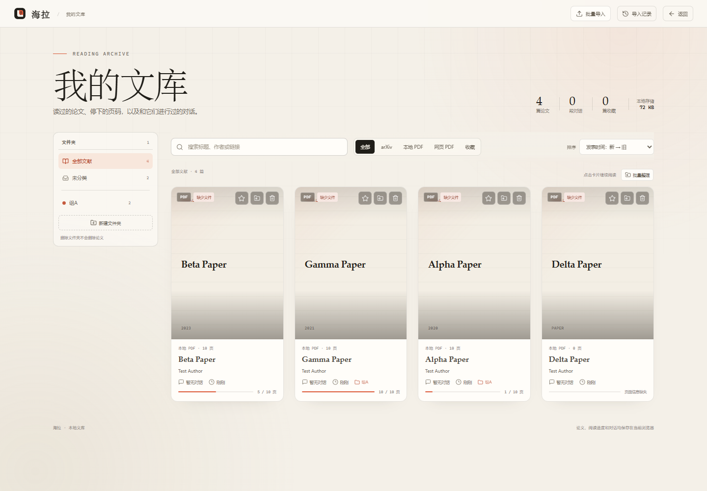

## 功能

- **arXiv 导入**：同时支持 `/abs/` 和 `/pdf/` 链接（含版本号、无协议链接、带查询参数、旧式 ID 和直接粘贴编号），服务端代理下载 PDF 并缓存。元数据 API 不可用时会回退到 abs 页面，再回退到 PDF 内置信息，尽量保证论文仍能打开。
- **任意 PDF 直链**：粘贴任何返回 PDF 文件的 `http/https` 链接，由本地服务下载并校验 PDF 文件头后，使用与 arXiv 相同的阅读、AI 对话、文库和文件夹能力。网页 HTML 页面、需要登录的链接或超过 80 MB 的文件会给出明确错误。
- **批量导入**：在一个窗口里混合粘贴多个 arXiv 编号 / PDF 直链、导入 TXT 链接清单，并选择多个本地 PDF；可以选择一个目标文件夹，让本批论文直接进入该文件夹。逐项显示下载、解析、保存进度和错误。多选文件拖入页面也会打开批量导入。
- **后台导入**：运行中的批量导入可以最小化到后台，继续浏览文库、阅读论文或返回首页；左下角持续显示进度和结果，点击即可恢复完整任务面板。
- **导入失败记录**：每次有失败或中途取消的批量导入都会按日期和时间保存，记录目标文件夹、成功/失败数量，以及失败条目的链接或文件名和具体错误；可在文库右上角「导入记录」查看和清空。
- **本地 PDF**：拖拽或选择文件，浏览器内解析版面与全文，文件本身不上传远端。
- **连续阅读器**：基于 PDF.js 渲染原始页面，支持页码跳转、缩放、适应宽度、在新窗口打开原始文件。
- **划词翻译**：在 PDF 上划选文字，自动用配置的模型翻译，并根据原文语言自动选择中文或英文为目标语言；支持复制译文，也可在 PDF 工具栏临时关闭划词翻译。
- **PDF 全文翻译**：连接本机 zotero-pdf2zh 服务后，在阅读器顶部一键生成中文单语 PDF；通过 EN / 中文按钮在同一个阅读器中切换，保留当前页码，不额外显示翻译文件。
- **本地文库**：自动收藏读过的论文，支持全文搜索、按 arXiv / 本地 / 网页 PDF / 收藏筛选、收藏和删除；每篇论文保存原始阅读位置。
- **多字段排序**：全部文献和任意文件夹中都可按阅读进度、标题、发表时间正序或倒序排列，同时保留最近打开 / 最近添加排序。
- **文件夹管理**：可新建、重命名、删除文件夹，并把论文移动到任意文件夹；侧栏显示每个文件夹的论文数量。删除文件夹只会把论文移到「未分类」，不会删除论文。
- **批量整理**：在文库中进入批量整理模式，多选或全选当前筛选结果，一次性把选中的论文移动到任意文件夹或未分类；分批操作可以把不同论文整理到不同文件夹。
- **历史对话**：每篇论文可保存多段对话，自动用首个问题命名，支持切换、重命名、删除和开始新对话。
- **续读**：重新打开文库中的论文时，恢复上次阅读页码和最近一段对话。
- **论文感知对话**：从抽取文本中检索与问题相关的片段，并结合开头、章节入口、结论和当前阅读页构造上下文，而不是只依靠摘要。
- **流式 AI 回答**：Markdown、表格、KaTeX 公式渲染；回答中的「第 N 页」引用可点击跳回原文。
- **精读动作**：一页速览、方法拆解、实验审视、局限与启发，也可以自由提问。
- **当前页上下文**：打开「结合第 N 页」后，提问会优先纳入当前阅读页。
- **多模型**：DeepSeek、OpenAI、Anthropic，以及任意 OpenAI 兼容接口（Ollama、vLLM、One API 等）。
- **模型自动发现**：填写 Base URL 和 API Key 后，点击「获取列表」从服务商的 `/models` 接口读取当前可用的模型，支持搜索并一键填入。
- **常用模型**：把模型名称、服务商、Base URL 和 Key 保存为常用配置；下次打开设置直接点「使用」切换，不必重新填写。保存的配置只存在当前浏览器。
- **响应式**：桌面左右分栏可拖动调整；移动端在「论文原文 / AI 伴读」之间切换。

## 快速开始

要求 Node.js **22+**（开发时使用 Node 25 验证；自动读取代理需要 Node.js 24+）。

```bash
npm install
npm run build
npm start
```

打开 **http://127.0.0.1:8787**。

### 通过本地代理访问 OpenAI

Windows 的系统代理不会自动被 Node.js 继承；浏览器能访问 OpenAI，不代表本地服务也能访问。把代理写进项目根目录的 `.env`：

```env
HTTPS_PROXY=http://127.0.0.1:6518
HTTP_PROXY=http://127.0.0.1:6518
NO_PROXY=localhost,127.0.0.1,::1
```

`npm start` 会先读取 `.env`，再通过 `server/start.mjs` 把代理环境传给 Node。Node.js 24+ 会启用内置的 `--use-env-proxy`；Node.js 22 只能直连模型网关。代理端口请换成你本机代理软件的实际端口。

开发模式（Vite 前端 + 独立 API 服务）：

```bash
npm run dev
# 前端 http://127.0.0.1:5173
# API   http://127.0.0.1:8787
```

## 配置 AI 模型

首次使用时，点击页面右上角的「配置 AI 模型 / 连接模型」，选择服务商并填入 API Key。配置默认只保存在当前浏览器（localStorage / sessionStorage），请求由本地服务转发，不写入服务器。

内置默认值：

| 服务商 | Base URL | 默认模型 |
| --- | --- | --- |
| DeepSeek | `https://api.deepseek.com` | `deepseek-chat` |
| OpenAI | `https://api.openai.com/v1` | `gpt-4o-mini` |
| Anthropic | `https://api.anthropic.com` | `claude-sonnet-4-20250514` |
| 自定义 / 本地 | 自行填写 | 自行填写 |

模型名称、Base URL 都可在设置中修改。只要接口兼容 OpenAI Chat Completions，即可用「自定义 / 本地」接入。

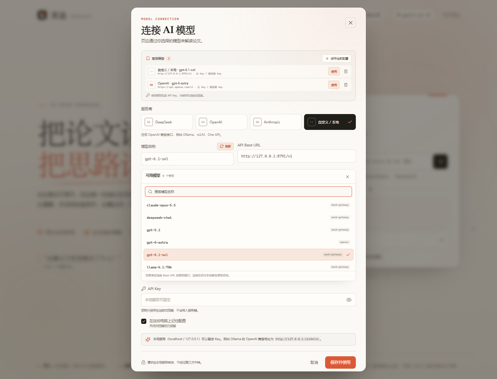

### 自动获取模型列表

1. 选择服务商，填好 Base URL 和 API Key。
2. 点击「模型名称」右侧的 **获取列表**。
3. 从返回的模型中选择一个；列表支持按模型名、显示名和归属方搜索。

不同服务商的读取方式：

- OpenAI / DeepSeek / 自定义：`GET {Base URL}/models`，使用 `Authorization: Bearer <Key>`。
- Anthropic：`GET {Base URL}/v1/models`，使用 `x-api-key` 和 `anthropic-version`，并自动读取分页。
- 如果网关没有实现 `/models`、需要额外请求头，或只返回网页 HTML，会显示错误；此时仍可手动填写模型名称。

### 保存常用模型

- 点击「保存当前配置」会把当前服务商、模型名称、Base URL 和 API Key 保存为一条常用配置。
- 点击「保存并使用」也会自动把这次配置加入常用模型。
- 常用模型列表中的「使用」会立即切换并关闭设置；垃圾桶按钮删除该条配置。
- 常用配置（包括 API Key）保存在当前浏览器 `localStorage`，不会上传到服务器；清除站点数据会一并删除。

### 让所有访问者共用服务器 Key（可选）

把 `.env.example` 复制为 `.env`，填入：

```env
AI_PROVIDER=deepseek
AI_API_KEY=sk-...
AI_BASE_URL=https://api.deepseek.com
AI_MODEL=deepseek-chat
MAX_CONTEXT_CHARS=46000
PORT=8787
```

重启服务后，浏览器端可以留空 Key，直接使用服务器配置。浏览器自己填写的 Key 优先。

### 本地模型示例（Ollama）

在设置中选择「自定义 / 本地」：

- Base URL：`http://127.0.0.1:11434/v1`
- 模型：例如 `qwen2.5:7b`
- API Key：可留空（localhost 被识别为本地服务）

## 文库与历史对话

- 每次成功导入论文后，应用会把论文元数据、抽取文本、PDF 原件（若浏览器允许）和封面缩略图写入浏览器 **IndexedDB**。
- 点击顶部的「文库」进入管理页：搜索标题 / 作者 / 摘要 / arXiv 编号 / PDF 链接，按来源或收藏筛选。文库右上角的「批量导入」可以继续添加链接和文件。
- 排序方式：最近打开、最近添加、阅读进度（高→低 / 低→高）、标题（升序 / 降序）、发表时间（新→旧 / 旧→新）。排序对「全部文献」和任意文件夹同时生效，并可与搜索、来源筛选组合使用。
- 阅读进度按「已读页数 / 总页数」计算；没有发表时间的本地或网页 PDF 在发表时间排序中始终排在最后。
- 左侧文件夹栏支持「全部文献 / 未分类」以及自建文件夹。点「新建文件夹」创建，悬停文件夹可重命名或删除。
- 把论文加入文件夹：点击卡片右上角的文件夹按钮，在弹出的列表中选择目标文件夹或「未分类」。卡片会在「全部文献」中显示所属文件夹。
- 删除文件夹时，其中的论文会移动到「未分类」，论文、PDF 和对话都会保留。
- 卡片显示阅读进度、对话数量和最近打开时间。删除论文会同时删除它的 PDF 数据、阅读进度和所有对话。
- 对话保存在当前论文下。聊天标题栏的历史按钮会打开对话抽屉，其中显示该论文的所有对话；可重命名或删除。
- 文库中记录的最后阅读页码会在再次打开时恢复；最新对话也会自动载入。
- 所有数据只在本机浏览器，不提供账号同步。清除浏览器站点数据会清空文库；页面会显示浏览器为本站估算的本地存储占用。

### 批量整理论文

在文库结果行右上角点击「批量整理」：

- 点击任意卡片选择或取消选择，卡片右上角会显示选中状态。
- 「全选当前」选择当前文件夹、搜索和来源筛选下的全部结果；「取消全选」或「清空」可重置。
- 底部工具栏显示已选数量，点击「移动到文件夹」选择目标文件夹或「未分类」。
- 一次操作会给所有选中论文设置同一个目标文件夹；分批选择不同论文并重复操作，就能整理到不同文件夹。
- 批量移动只修改文件夹归属，不改变 PDF、阅读进度、收藏状态或对话。
- 点击「完成」退出整理模式。

### 批量导入与 TXT 链接

点击首页或文库右上角的「批量导入」：

- **链接**：每行一个 arXiv 编号 / 链接或 PDF 直链，也可以直接粘贴多行。
- **导入 TXT**：选择 `.txt` 文件后，会按行识别 arXiv 链接、PDF 直链和 Markdown 链接；无法识别的行会被跳过，识别结果会追加到链接输入框并显示统计。
- **本地 PDF**：可多选；只在当前浏览器解析。
- **导入到文件夹**：选择一个已有文件夹后，本批导入的论文会直接写入该文件夹；如果论文已经存在，也会移动到所选文件夹。选择「不指定」则保持原文件夹，新论文进入未分类。

### 后台导入

批量导入开始后，点击底部的「后台运行」可以收起导入窗口：

- 左下角会出现一个常驻进度条，显示当前任务、整体进度和完成状态。
- 后台运行期间仍可打开文库、阅读其他论文或返回首页。
- 点击「查看进度 / 查看结果」可恢复完整导入面板。
- 导入完成时会在左下角显示成功数或失败数；失败批次仍会写入「导入记录」。
- 后台导入是**浏览器内任务**，页面必须保持打开；刷新或关闭页面会中断未完成的部分。页面会在有后台任务运行时提示确认离开。
- 已显示「已保存到文库」的论文即使之后中断也会保留。

TXT 识别规则：

- 单独一行的 URL、Markdown 链接，或行内出现的 arXiv / PDF 直链会被识别；
- 普通网页 URL 只有在整行只有一个链接时才会作为候选，最终仍由服务端校验是否为 PDF；
- 空行不计数；没有任何可识别链接的非空行会计入「跳过」；
- 重复链接会自动去重，文件最大 2 MB。

### 导入失败记录

批量导入只要出现失败或中途取消，就会自动留下记录：

- 点击文库右上角的「导入记录」查看。
- 按「今天 / 昨天 / 具体日期」分组，每条显示开始的时、分、秒。
- 每次记录包含总条目数、成功数、失败数、取消数，以及目标文件夹。
- 失败或取消的条目会显示原始链接 / 文件名和具体错误，例如 404、不是有效 PDF、不是有效链接。
- 全部成功的批次不会占用失败记录空间。
- 最多保留最近 200 次有问题的导入；「清空记录」只清历史，不会删除文库论文。
- 记录保存在当前浏览器的 IndexedDB 中，包含导入链接、文件名和错误信息。

## 划词翻译

- 在 PDF 原文上拖选文字，停顿约 0.3 秒后自动出现翻译浮层并开始请求。
- 源文本主要为英文时译为中文，主要为中文时译为英文；论文标题和当前页正文会作为术语与指代参考发送给模型。
- 翻译使用同一套模型配置。未配置模型时会提示「去配置」，配置保存后会自动继续翻译。
- 浮层支持复制译文；点击浮层外、滚动 PDF 或按 `Esc` 会关闭。
- PDF 工具栏的「划词」按钮可以临时关闭自动翻译。关闭后文字仍可选择、复制。
- 扫描版 PDF 没有文字层，无法划选，因此也不能使用划词翻译。
- 划词内容只用于本次翻译，不会写入对话历史；聊天记录仍按论文单独保存。

## 工作原理

1. 浏览器通过 PDF.js 加载 PDF，并用 `getTextContent()` 抽取每页文字，保留页码；同时把文字层铺在页面上，支持划选。
2. 服务端把正文切成约 1k–2k 字符的片段，用轻量 BM25 风格检索结合章节入口与全文覆盖采样，选出适合当前问题的片段。
3. 模型收到：系统阅读规则 + 论文元数据/摘要 + 相关正文片段 + 对话历史。
4. 回答通过 SSE 流式返回，前端实时渲染 Markdown 和公式。
5. 划词翻译单独调用 `/api/translate`，传入选中文本、当前页上下文与论文标题，只要求模型输出译文。
6. arXiv PDF 下载后会缓存到 `.cache/arxiv/` 供服务端代理使用；浏览器端会把 PDF、文本与对话另存到 IndexedDB。本地 PDF 不写入服务器。
7. 任意 PDF 直链由 `/api/pdf/fetch` 在服务端下载并校验 `%PDF` 文件头，再返回浏览器解析。该接口会阻止本机、内网和云元数据地址，限制 80 MB、超时 60 秒，并逐跳校验重定向；不把远程 PDF 持久化到服务器。批量导入按顺序复用同一流程，逐篇写入 IndexedDB。
8. 设置页的模型列表通过 `/api/models` 转发到当前 Base URL：OpenAI 兼容服务读取 `/models`，Anthropic 读取 `/v1/models`。常用模型保存在浏览器本地，切换时直接恢复对应配置。

## PDF 全文翻译（zotero-pdf2zh）

海拉可以对接 `guaguastandup/zotero-pdf2zh` 提供的本地 HTTP 服务，把整篇 PDF 翻译成中文单语版本。该仓库本身是 AGPL-3.0 的 Zotero 插件与 Python 服务，不包含 `SKILL.md`；海拉不复制其插件代码，只通过 HTTP 协议调用服务。

### 启动服务

先在 pdf2zh 的 Python 环境中启动服务端，默认地址为 `http://127.0.0.1:8890`。服务端需要提前配置好翻译服务与模型 Key（例如 OpenAI、DeepSeek、SiliconFlow 或免费服务）。海拉不会读取或保存 pdf2zh 服务的模型 Key。

### 在海拉中配置

打开「连接 AI 模型」设置，在「PDF 全文翻译」区域填写：

- **服务地址**：例如 `http://127.0.0.1:8890`
- **翻译引擎**：`pdf2zh_next / BabelDOC` 或 `pdf2zh 1.x`
- **翻译服务**：与服务端配置一致，例如 `siliconflowfree`、`openai`、`deepseek`、`bing`

保存后打开任意论文，点击 PDF 顶部的「翻译 PDF」。

### 使用行为

- 翻译任务在后台轮询，工具栏显示进度。
- 生成的是**中文单语** PDF；不会新增文库卡片，也不会单独打开翻译文件。
- 完成后自动切换到中文版本，工具栏出现 `EN / 中文` 切换按钮。
- 切换时保留当前阅读页码；关闭页面后，翻译 PDF 会保存在当前浏览器的 IndexedDB 中，下次打开可直接切换。
- PDF 原文会发送到你配置的本机 pdf2zh 服务；服务端会再把它发送给所选的翻译模型。翻译结果只保存在当前浏览器。
- 如果服务未启动、地址错误或服务端模型未配置，工具栏会显示失败，可点击「重试翻译」。

## 项目结构

```
src/
  App.tsx                    应用状态、导入流程、对话流
  components/
    Landing.tsx              首页与导入
    BatchImportModal.tsx     批量链接 / 本地文件导入
    ImportHistoryModal.tsx   导入失败记录查看
    PdfViewer.tsx            PDF.js 连续阅读器
    ChatPanel.tsx            对话、快捷动作、输入区
    MarkdownMessage.tsx      Markdown / 表格 / KaTeX
    SettingsModal.tsx        模型配置
    LibraryModal.tsx         本地文库管理
    HistoryDrawer.tsx        单篇论文的对话历史
    TranslationPopover.tsx   划词翻译浮层
  lib/
    pdf.ts                   PDF 加载、文本抽取、标题识别、缩略图
    batchImport.ts           单篇 / 批量导入流水线
    linkText.ts              TXT 链接识别与逐行过滤
    paperId.ts               arXiv / 本地 / 网页 PDF 的稳定 ID
    api.ts                   arXiv、PDF 代理与聊天 SSE 客户端
    config.ts                当前模型配置与持久化
    modelProfiles.ts         常用模型配置的保存、切换与删除
    pdfTranslation.ts        pdf2zh 服务配置、提交、轮询与结果下载
    library.ts               IndexedDB 论文 / PDF / 对话 / 翻译 / 导入记录存储
server/
  start.mjs                  读取 .env、代理环境后启动服务
  index.mjs                  Express API、静态站点、SSE
  arxiv.mjs                  arXiv 校验、元数据、PDF 缓存
  pdf-proxy.mjs              任意 PDF 直链下载、SSRF 防护
  pdf2zh.mjs                 pdf2zh 服务代理：提交、任务查询、翻译 PDF 下载
  context.mjs                文本分块、检索、提示词
  providers.mjs              OpenAI 兼容 / Anthropic 流式适配、模型列表
public/pdfjs/                PDF.js 的 cmaps、字体、wasm 资源
```

## 隐私与边界

- 正常阅读时，本地 PDF 文件不会上传到远端；它和抽取文本、对话历史一起保存在当前浏览器的 IndexedDB 中。提问时会把解析后的相关文本片段随问题发送给你配置的模型；划词翻译时会发送选中文本、当前页上下文和论文标题。
- 使用 PDF 全文翻译时，原始 PDF 会发送到你填写的 pdf2zh 服务地址；如果该地址不是本机，文件会离开这台电脑。翻译后的 PDF 保存在当前浏览器，删除论文时会一并删除。
- 任意 PDF 直链由本机服务下载，下载后的 PDF 与本地文件一样只保存在浏览器 IndexedDB；原始链接会随论文记录保存在浏览器中。服务端不会长期保留远程 PDF。
- API Key 保存在浏览器；若使用 `.env` 配置服务器 Key，则 Key 只在本地服务进程中。
- 「常用模型」会把名称、Base URL、模型名称和 API Key 一起保存在当前浏览器的 `localStorage`。读取模型列表时，Key 由本地服务转发给所选网关，但不会写入磁盘；清除站点数据会删除常用配置。
- 导入失败记录保存在浏览器 IndexedDB，包含失败的 PDF 链接、本地文件名和错误信息，最多 200 次；可以在记录窗口清空，不影响论文。
- 文库没有云同步，换浏览器或清除站点数据后不会保留；如需迁移，请先导出原始 PDF。
- 扫描版 PDF 没有 OCR。能阅读原文，但 AI 可依据的文字很少，界面会提示。
- PDF 文本层可能有乱序、断词或公式丢失，回答时模型会尽量结合上下文修复，但仍建议核对原文。
- 本项目面向本地/个人使用：没有用户系统、鉴权、限流和多租户隔离。**不要直接暴露到公网**而不加保护。
- 公开部署时还要注意 arXiv 的使用条款与请求频率；缓存已减少重复下载。

## 常见问题

**提问后提示「请先配置 AI 模型 API Key」？**  
点击右上角模型按钮，填入 Key；或按上面的方式配置 `.env`。

**arXiv 打不开？**  
链接支持 `https://arxiv.org/abs/...`、`https://arxiv.org/pdf/...`、`https://arxiv.org/pdf/....pdf` 以及带版本号的链接，也可以直接粘贴编号。元数据和 PDF 都配置了备用地址；如果全部失败，界面会给出提示，也可以先把 PDF 下载到本地再拖入。偶尔遇到 arXiv 访问限制时，稍后重试通常即可。

**任何 PDF 链接都能导入吗？**

需要是直接返回 PDF 文件的 `http/https` 链接。普通网页、需要登录/Cookie 的下载页、返回 HTML 的跳转页会失败；单份文件上限 80 MB。出于安全原因，本机地址、局域网地址和云元数据地址会被拒绝。如果链接会触发下载而不是直接返回文件，建议先下载到本地，再用批量导入选择文件。

**批量导入时关闭页面会怎样？**

已经显示「已保存到文库」的论文会保留；正在下载/解析的那一篇可能中断。重新打开页面后可以在文库中确认，未完成的项目重新导入即可。重复导入同一篇 arXiv 论文、同一份本地文件或同一个 PDF 链接会更新原记录，不会产生重复卡片。

**TXT 里有些行没有被识别？**

TXT 按行处理，无法识别的行会跳过。请确保 arXiv 链接 / PDF 直链所在行没有多余字符，或者把链接单独放在一行；普通网页 URL 只有整行仅包含该链接时才会进入候选。TXT 文件上限 2 MB。

**模型报 404 / 401？**  
检查设置里的 Base URL 与模型名是否匹配。OpenAI 兼容接口的 Base URL 通常要带 `/v1`（例如 `https://api.openai.com/v1`）。

**「获取列表」失败或列表为空？**

先确认 Base URL 能在浏览器外访问，并且服务商开放了 `/models`。部分网关只提供 Chat Completions、不允许列出模型，或需要额外的组织/项目请求头；这种情况直接手动填写模型名称即可。OpenAI 兼容网关通常要求 Base URL 带 `/v1`。

**提示「无法连接模型网关：fetch failed」？**

这是本地服务的出站网络问题，不是模型名错误。官方 OpenAI 在当前网络通常需要代理：浏览器的系统代理不会自动传给 Node.js。按上面的「通过本地代理访问 OpenAI」在 `.env` 配置代理后重新执行 `npm start`。可以用一个无效 Key 测试 `/api/models`：如果返回 401（而不是超时/502），说明网络已经连通，只需换成有效 Key。

**回答太长或模型上下文超限？**  
可在 `.env` 调整 `MAX_CONTEXT_CHARS`（默认 46000，范围 9000–120000）。数值越小，发送的片段越少。

**文库数据存在哪里？浏览器空间不足怎么办？**  
存在当前浏览器的 IndexedDB。空间不足时应用会优先保住论文信息、文本与对话；如果 PDF 原件保存失败，卡片会标记「缺少文件」，重新导入原文件即可恢复。清除浏览器站点数据会删除整个文库和文件夹。

**删除文件夹会删除论文吗？**  
不会。删除文件夹时，其中的论文会自动移动到「未分类」，PDF、阅读进度和对话都保留。

**想删除某篇论文或某段对话？**  
在文库卡片右上角删除整篇论文；在聊天历史抽屉里删除单段对话。删除论文会同时删除其 PDF、进度和全部对话。

**划选文字没有出现翻译浮层？**  
先确认 PDF 中能选中文字（扫描件没有文字层，无法划词）；再确认工具栏的「划词」按钮处于高亮开启状态。若浮层提示配置模型，按提示填入 API Key 后会自动重试。

## 说明

项目已用真实的 arXiv 论文、网页 PDF 直链和本地 PDF 做浏览器端验证，并使用本地 mock 模型验证了流式对话、错误提示、重试、页码跳转、当前页上下文、停止生成、文库持久化、对话历史、文件夹创建/移动/重命名/删除与旧版 IndexedDB 迁移、任意 PDF 直链、批量链接/文件混合导入、TXT 链接识别、目标文件夹导入、批量整理论文到不同文件夹、按进度/标题/发表时间正倒序排序、后台导入跨页面运行与恢复、导入失败记录与跨刷新持久化、多文件拖入、来源筛选、模型列表读取、常用模型保存/切换/删除、划词翻译、翻译请求取消/关闭、pdf2zh 代理协议与中文单语 PDF 同页切换和移动端布局。真实第三方模型与真实 pdf2zh 翻译需要在界面和 pdf2zh 服务端配置后进行。
