# 海拉 · Haila

**v1.11.1** · 本地优先的 AI 论文精读工作台

把论文读薄，把思路读厚。左侧显示论文原始 PDF，右侧是一个读过全文、回答带页码的 AI 精读伙伴。

支持三种入口：**粘贴 arXiv 链接 / 编号**、**任意 PDF 直链**，或**拖入本地 PDF**；也可以把多个链接和文件一次批量导入。论文会自动进入本地文库，聊天记录按论文分组保存；在原文中划选文字即可自动翻译。

[一键部署](#一键部署) · [一键升级](#一键升级) · [桌面快捷方式](#桌面快捷方式) · [Agent 自动部署手册](AGENTS.md) · [版本历史](#版本历史) · [完整日志](CHANGELOG.md) · [隐私与边界](#隐私与边界)

## 版本历史

当前版本 **v1.11.1**。下表列出全部版本，完整逐条记录见 [CHANGELOG.md](CHANGELOG.md)。

| 版本 | 日期 | 主要变化 |
| --- | --- | --- |
| **v1.11.1** | 2026-11-12 | 优化文件夹折叠指示器与左侧对齐 |
| v1.11.0 | 2026-11-12 | 子文件夹折叠与拖放整理 |
| v1.10.0 | 2026-11-10 | 新增文献雷达：对话搜索论文并导入指定文件夹 |
| v1.9.5 | 2026-11-06 | PDF 文件上限提高到 120 MB |
| v1.9.4 | 2026-11-06 | PDF 阅读工具栏自动收起，减少遮挡 |
| v1.9.3 | 2026-11-06 | 识别无效翻译结果；成功后也可重译 |
| v1.9.2 | 2026-11-06 | 修复 PDF 翻译失败后无法重新翻译 |
| v1.9.1 | 2026-11-06 | 已读论文默认隐藏；PDF 翻译 API 自动读取模型 |
| v1.9.0 | 2026-11-05 | 文件夹支持多级子文件夹，父级汇总与筛选 |
| v1.8.3 | 2026-11-05 | 修复导入遮罩无法退出，新增关闭/背景取消 |
| v1.8.2 | 2026-11-03 | DeepSeek 默认模型更新为 deepseek-flash |
| v1.8.1 | 2026-11-03 | 新增 npm run setup:api:ui：Windows 图形界面填写 DeepSeek/OpenAI/兼容 API。 |
| v1.8.0 | 2026-11-03 | npm run deploy 增加环境预检、安装验证和部署状态记录；依赖安装改用 npm ci。 |
| v1.7.0 | 2026-11-03 | 接入 OpenAI Responses API 的 web_search 工具。 |
| v1.6.1 | 2026-11-03 | 移除前端的图片管理入口和图片库界面，图片仍自动保存在后台 .runtime/images。 |
| v1.6.0 | 2026-11-03 | 新增站点图片存储：发给智能体的图片自动保存到本机 .runtime/images 并生成稳定链接。 |
| v1.5.1 | 2026-11-03 | 修复归档当前正在阅读的论文后跳回首页的问题：现在会退出阅读器并留在文库。 |
| v1.5.0 | 2026-11-02 | 新增图片理解：支持直接粘贴、选择文件或拖入图片后向智能体提问。 |
| v1.4.0 | 2026-11-02 | 新增智能体回答风格设置：平衡、详细、简洁、严谨批判、导师启发和自定义。 |
| v1.3.1 | 2026-11-02 | 记住文库列表的滚动位置：进入论文后返回文库会回到原位置。 |
| v1.3.0 | 2026-11-02 | 新增完整数据备份：论文 PDF、翻译、对话、笔记、文件夹、导入记录和模型设置打包为 ZIP。 |
| v1.2.1 | 2026-11-02 | 阅读笔记按钮从顶部工具栏移到阅读器右下角，改为悬浮圆形文档按钮。 |
| v1.2.0 | 2026-11-02 | 新增每篇论文独立的 Markdown 阅读笔记，圆形文档按钮切换。 |
| v1.1.0 | 2026-11-02 | 新增手动阅读状态：未读 / 进行中 / 已读 / 归档，打开论文不会自动改状态。 |
| v1.0.9 | 2026-10-30 | PDF 全文翻译不再限定 DeepSeek：支持 OpenAI 和任意 OpenAI 兼容 API。 |
| v1.0.8 | 2026-10-30 | 修复后台翻译指示器展开时的一帧跳变。 |
| v1.0.7 | 2026-10-30 | 后台 PDF 翻译指示器启动时完整显示，1.5 秒后自动收起为左下角小圆环。 |
| v1.0.6 | 2026-10-30 | PDF 翻译改为应用级后台任务：退出文档、返回首页或打开其他论文不会中断。 |
| v1.0.5 | 2026-10-30 | 修复 DeepSeek 接口返回 400、模型名不在支持列表的问题。 |
| v1.0.4 | 2026-10-30 | 新增 PDF 翻译日志查询面板：支持 pdf2zh 服务 / 海拉启动两个来源。 |
| v1.0.3 | 2026-10-30 | 修复首次 DeepSeek 配置反复弹出的问题：只有完全没有模型 API/URL 时才显示。 |
| v1.0.2 | 2026-10-30 | 新增一键启动脚本和桌面快捷方式：双击后后台启动海拉、自动启动 pdf2zh 并打开浏览器。 |
| v1.0.1 | 2026-10-29 | 支持 arXiv、任意 PDF 直链和本地 PDF 导入，保留原始 PDF 与全文解析。 |

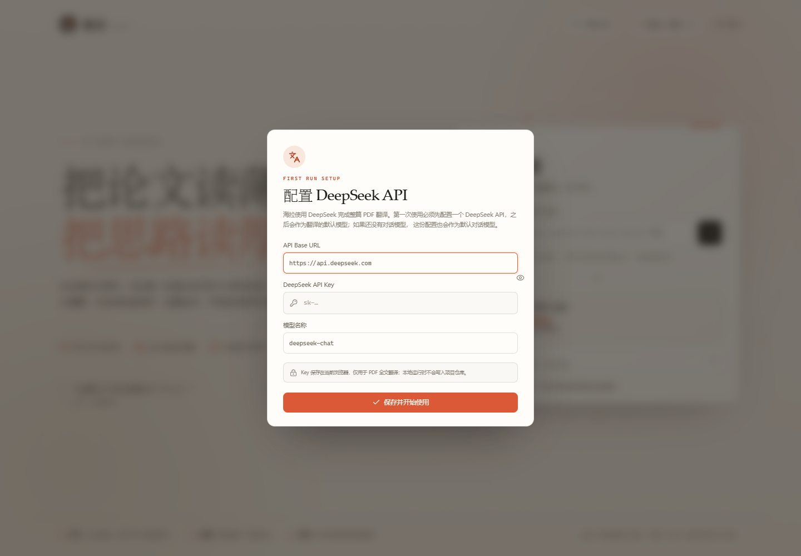

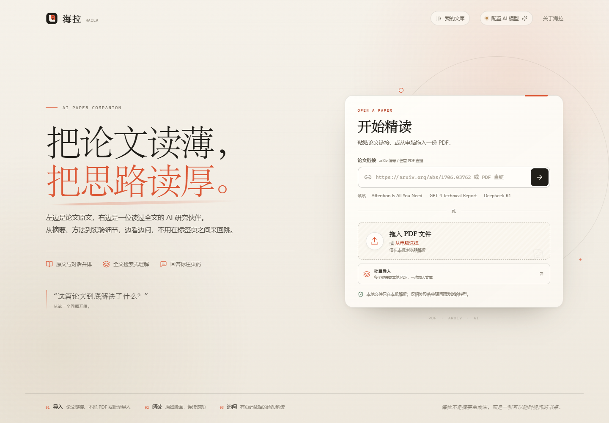

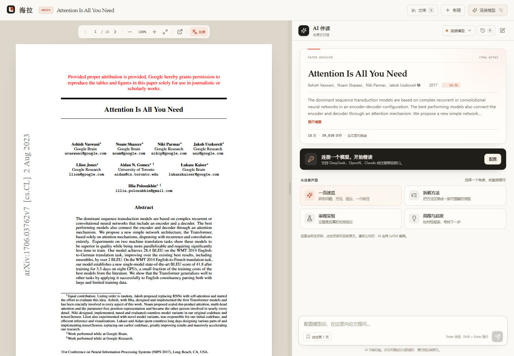

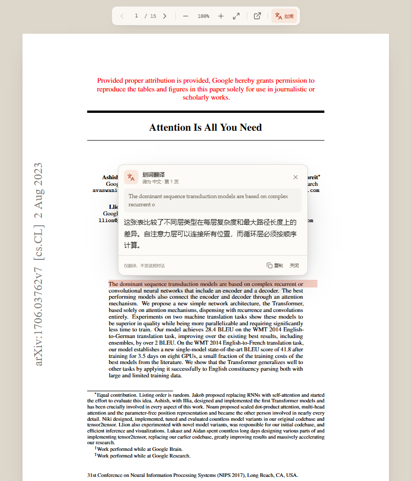

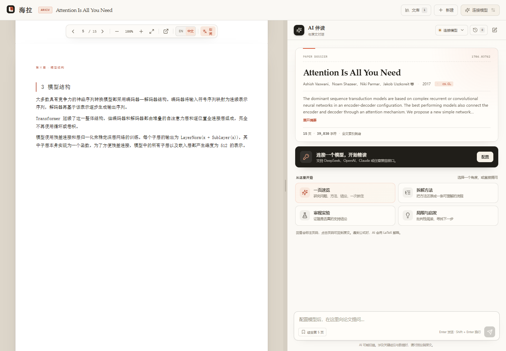

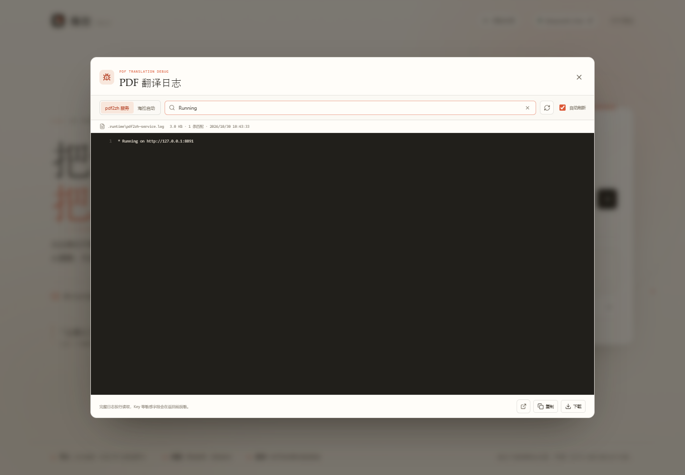

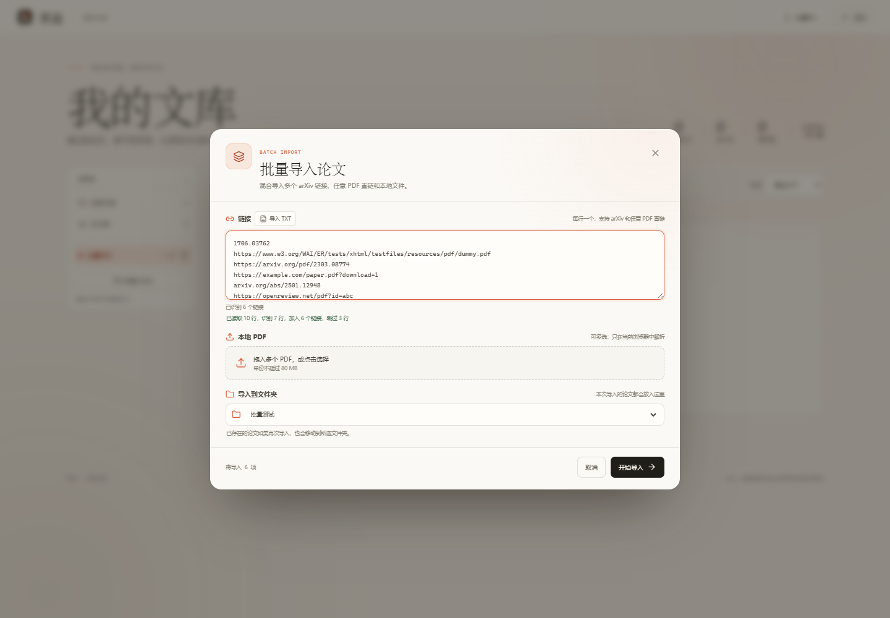

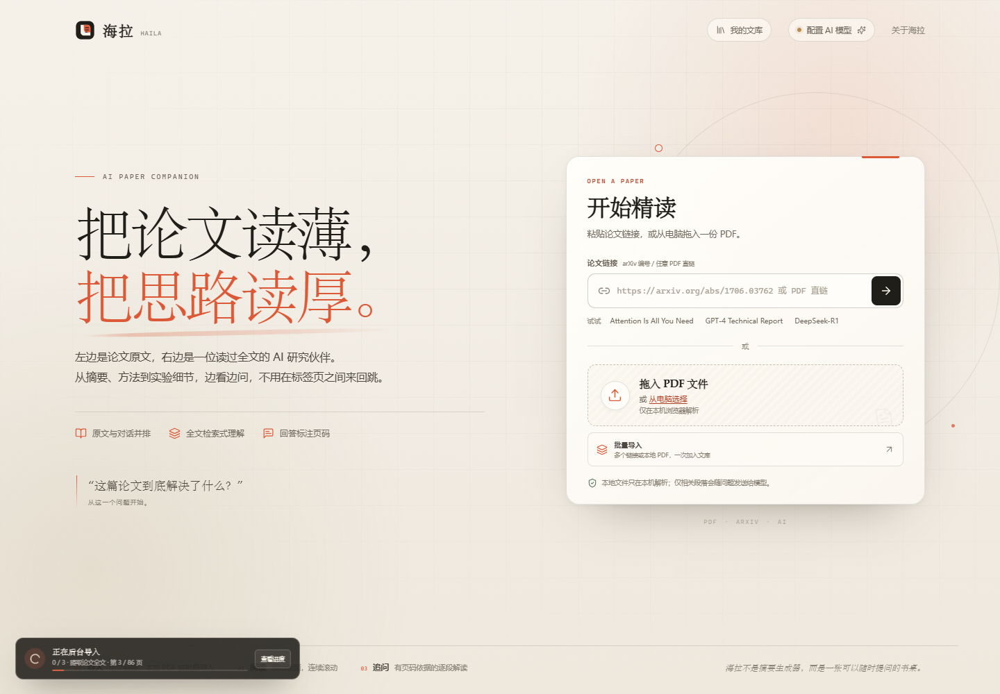

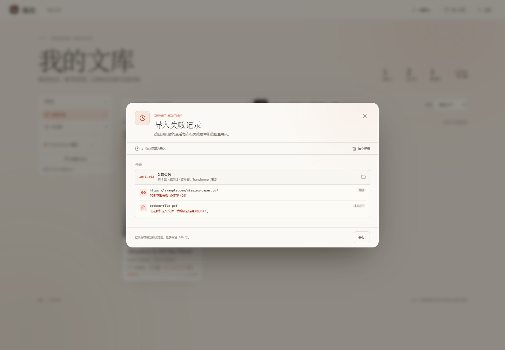

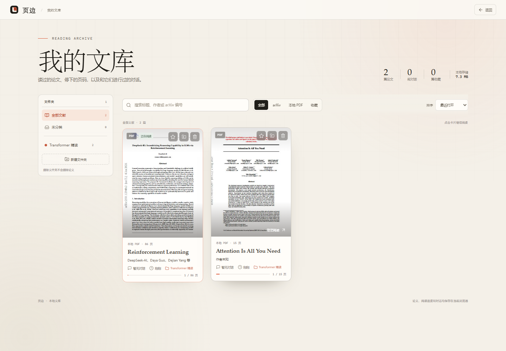

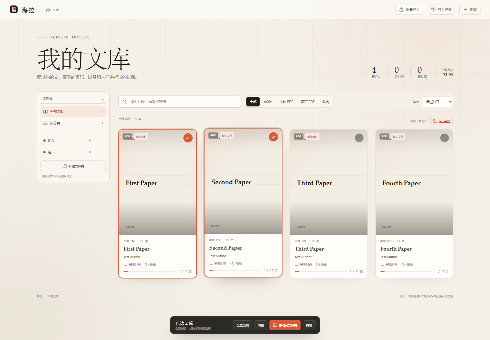

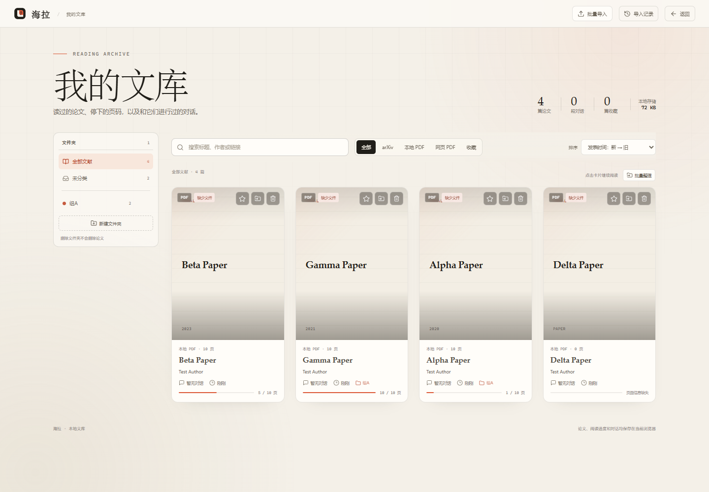

## 功能

- **arXiv 导入**：同时支持 `/abs/` 和 `/pdf/` 链接（含版本号、无协议链接、带查询参数、旧式 ID 和直接粘贴编号），服务端代理下载 PDF 并缓存。元数据 API 不可用时会回退到 abs 页面，再回退到 PDF 内置信息，尽量保证论文仍能打开。
- **任意 PDF 直链**：粘贴任何返回 PDF 文件的 `http/https` 链接，由本地服务下载并校验 PDF 文件头后，使用与 arXiv 相同的阅读、AI 对话、文库和文件夹能力。网页 HTML 页面、需要登录的链接或超过 120 MB 的文件会给出明确错误。
- **批量导入**：在一个窗口里混合粘贴多个 arXiv 编号 / PDF 直链、导入 TXT 链接清单，并选择多个本地 PDF；可以选择一个目标文件夹，让本批论文直接进入该文件夹。逐项显示下载、解析、保存进度和错误。多选文件拖入页面也会打开批量导入。
- **后台导入**：运行中的批量导入可以最小化到后台，继续浏览文库、阅读论文或返回首页；左下角持续显示进度和结果，点击即可恢复完整任务面板。
- **导入失败记录**：每次有失败或中途取消的批量导入都会按日期和时间保存，记录目标文件夹、成功/失败数量，以及失败条目的链接或文件名和具体错误；可在文库右上角「导入记录」查看和清空。
- **本地 PDF**：拖拽或选择文件，浏览器内解析版面与全文，文件本身不上传远端。
- **连续阅读器**：基于 PDF.js 渲染原始页面，支持页码跳转、缩放、适应宽度、在新窗口打开原始文件。顶部工具栏会在约 3 秒后自动收起，鼠标移到顶部或点击小把手时临时展开；翻译进行中或失败时会保持可见。
- **划词翻译**：在 PDF 上划选文字，自动用配置的模型翻译，并根据原文语言自动选择中文或英文为目标语言；支持复制译文，也可在 PDF 工具栏临时关闭划词翻译。
- **PDF 全文翻译**：连接本机 zotero-pdf2zh 服务后，在阅读器顶部一键生成中文单语 PDF；通过 EN / 中文按钮在同一个阅读器中切换，保留当前页码，不额外显示翻译文件。翻译模型支持 DeepSeek、OpenAI 和任意 OpenAI 兼容 API；配置 API URL 和 Key 后会自动读取可用模型列表。
- **后台 PDF 翻译**：点击翻译后可以退出当前论文、返回首页或打开其他论文，任务继续在后台运行；完成后自动保存，重新打开论文即可切换中文。进度条会在 1.5 秒后自动收起为小圆环，悬停或点击可展开。
- **本地文库**：自动收藏读过的论文，支持全文搜索、按 arXiv / 本地 / 网页 PDF / 收藏筛选、收藏和删除；每篇论文保存原始阅读位置。
- **阅读状态与归档**：每篇论文手动标记未读 / 进行中 / 已读 / 归档，不随打开或阅读自动变化。已读论文默认从常规视图隐藏，但分类、原文、笔记和报告都保留，点击状态「已读」即可查看；归档会删除 PDF 原件、抽取全文和翻译 PDF，只保留论文名片、链接和对话。
- **Markdown 阅读笔记**：阅读器右下角的圆形文档按钮可以切换到当前论文的笔记；支持编辑、分栏预览、纯预览和自动保存。AI 对话可以读取笔记，也可以根据要求直接更新笔记。
- **完整备份与恢复**：把所有论文、PDF、翻译、对话、笔记、文件夹和模型设置打包成 ZIP；在另一台设备导入后自动恢复并打开上次阅读的论文。
- **多字段排序**：全部文献和任意文件夹中都可按阅读进度、标题、发表时间正序或倒序排列，同时保留最近打开 / 最近添加排序。
- **多级子文件夹**：文件夹可以继续新建子文件夹；子文件夹默认折叠，可逐级展开或一键展开/折叠全部。父文件夹显示包含后代在内的论文数，选中父文件夹会展示所有后代论文。文件夹和论文卡片都可以拖动到目标文件夹完成并入/归类；删除父文件夹时子文件夹提升到上一级，直属论文移动到上一级或未分类。
- **批量整理**：在文库中进入批量整理模式，多选或全选当前筛选结果，一次性把选中的论文移动到任意文件夹或未分类；分批操作可以把不同论文整理到不同文件夹。
- **历史对话**：每篇论文可保存多段对话，自动用首个问题命名，支持切换、重命名、删除和开始新对话。
- **续读**：重新打开文库中的论文时，恢复上次阅读页码和最近一段对话。
- **论文感知对话**：从抽取文本中检索与问题相关的片段，并结合开头、章节入口、结论和当前阅读页构造上下文，而不是只依靠摘要。
- **流式 AI 回答**：Markdown、表格、KaTeX 公式渲染；回答中的「第 N 页」引用可点击跳回原文。
- **精读动作**：一页速览、方法拆解、实验审视、局限与启发，也可以自由提问。
- **当前页上下文**：打开「结合第 N 页」后，提问会优先纳入当前阅读页。
- **图片理解**：直接把截图或图表粘贴到对话框，或点击图片按钮选择文件；支持 PNG / JPEG / WebP，最多 4 张，随问题一起发送给视觉模型。
- **多模型**：DeepSeek、OpenAI、Anthropic，以及任意 OpenAI 兼容接口（Ollama、vLLM、One API 等）。
- **OpenAI 联网搜索**：OpenAI 模型可在对话框一键启用 `web_search`，搜索论文之外的公开信息并附来源链接。
- **模型自动发现**：填写 Base URL 和 API Key 后，点击「获取列表」从服务商的 `/models` 接口读取当前可用的模型，支持搜索并一键填入。
- **文献雷达**：从首页或文库进入独立的对话搜索界面，用自然语言描述研究方向，自动联网检索论文，并把确认后的结果导入指定文件夹。OpenAI 模型使用联网搜索，其他模型使用 OpenAlex 学术文献库作为检索来源。
- **常用模型**：把模型名称、服务商、Base URL 和 Key 保存为常用配置；下次打开设置直接点「使用」切换，不必重新填写。保存的配置只存在当前浏览器。
- **智能体回答风格**：独立设置按钮中一键选择平衡、详细、简洁、严谨批判、导师启发的预设，也可以输入自定义风格描述；描述会作为上下文随每次提问发送给模型。
- **响应式**：桌面左右分栏可拖动调整；移动端在「论文原文 / AI 伴读」之间切换。
- **PDF 翻译日志**：设置页或翻译失败位置可直接打开日志面板，按来源查看、搜索、自动刷新、复制和下载；API Key 会自动脱敏。
- **翻译失败可恢复**：翻译失败时显示固定错误条，可直接重试、打开翻译设置或查看日志；翻译中也可以取消。每次重试都会创建新的翻译任务。翻译完成后如果检测不到中文内容，不会误报成功，而是提示重新翻译；成功状态也保留「重译」按钮。
- **可验证部署 / 升级**：`npm run deploy` 先做环境预检，再安装依赖、构建、命令行配置 API，最后启动临时服务做 HTTP 验证；pdf2zh 失败不会阻断核心功能。
- **一键升级**：`npm run upgrade` 拉取新版本、同步依赖、重新构建并验证。
- **桌面一键启动**：安装桌面快捷方式后，双击即可在后台启动海拉和独立 pdf2zh，并自动打开浏览器。

## 一键部署

### 运行环境与节点要求

| 项目 | 要求 |
|---|---|
| Node.js | **22+**；使用本地代理时必须 **24+** |
| 操作系统 | Windows 10/11 可使用桌面快捷方式；Linux/macOS 可手动 `npm start` |
| 网络 | 首次安装需要网络；模型网关需要可访问 |
| 代理节点 | HTTP/HTTPS 代理，推荐本地端口；填入 `.env` 的 `HTTPS_PROXY` / `HTTP_PROXY` |
| 端口 | Haila `8787`，pdf2zh `8891`；均只监听 `127.0.0.1` |
| 磁盘 | 约 900 MB 用于可选 pdf2zh 运行时和模型缓存 |
| Git | 一键升级需要；部署核心功能不强制 |
| Python | 可选；安装 pdf2zh 时需要 `uv` 或 Python 3.12 |
| 浏览器 | 现代 Chrome / Edge / Firefox；数据保存在 IndexedDB |

代理节点说明：

- Node.js 24+ 才能使用内置 `--use-env-proxy`；Node 22 只能直连模型网关。
- 当前启动器按 HTTP/HTTPS 代理环境变量工作，不承诺 SOCKS5 代理。
- 本地代理会做 TCP 探测；远程代理只按配置使用，不主动阻塞启动。
- arXiv、OpenReview、ACL、NeurIPS、IEEE、Springer 等学术站点默认绕过代理。

```bash
git clone https://github.com/ScallopShark-ai/page-margin.git haila
cd haila
npm run deploy
npm start
```

`npm run deploy` 会按顺序完成：

1. **环境预检**：Node、npm、Git、磁盘、代理、pdf2zh、`.env`
2. **命令行配置 API**：如果没有服务器 Key，提示输入 DeepSeek Key
3. 安装前端和服务端依赖（有 lockfile 时用 `npm ci`）
4. 尝试安装独立 pdf2zh；失败时默认继续部署核心功能
5. 构建海拉前端（包含 TypeScript 检查）
6. **启动冒烟测试**：临时启动服务，检查首页、静态资源、`/api/health`、图片接口
7. **模型网关测试**：如果服务器已配置 Key，调用 `/api/models` 验证网关和 Key
8. 写入 `.runtime/deployment-status.json`

首次部署会看到类似：

```text
首次部署：配置 DeepSeek API
DeepSeek API Key: ********
API Base URL [https://api.deepseek.com]:
模型 [deepseek-flash]:
```

Key 输入会遮罩，并写入项目根目录 `.env`。`.env` 已被 `.gitignore` 忽略。
配置后首次打开网页不会再弹出模型配置窗口；PDF 全文翻译也可以直接使用
`.env` 中的服务器 Key，不需要在浏览器重复输入。

如果部署由 Agent 执行、没有交互式 TTY，可以让它弹出配置界面，由用户填写：

```bash
npm run setup:api:ui        # Windows 图形界面
npm run setup:api:console   # 弹出新的命令行窗口
```

两个入口都会保留已有代理配置，只更新 `AI_*`；保存后回到 Agent 继续部署。

部署选项：

```bash
npm run deploy -- --skip-pdf2zh       # 不安装 PDF 翻译
npm run deploy -- --require-pdf2zh    # pdf2zh 安装失败则部署失败
npm run deploy -- --skip-api          # 跳过命令行 API 配置
npm run deploy -- --skip-verify       # 跳过安装验证（不推荐）
npm run deploy -- --skip-gateway      # 跳过网关 /models 测试
npm run deploy -- --require-gateway   # 网关测试失败则部署失败
npm run deploy -- --configure-api     # 强制重新配置 API
```

单独执行：

```bash
npm run doctor          # 只做环境预检
npm run verify          # 启动临时服务验证页面/API
npm run test:gateway    # 使用 .env 配置测试模型网关 /models
npm run configure:api   # 重新配置 .env 中的 DeepSeek API
npm run setup:api:ui    # 弹出图形界面填写 API
npm run setup:api:console # 弹出命令行窗口填写 API
```

网关测试默认只是**警告**，因为部分兼容网关没有实现 `/models`，但聊天接口仍然可用。
需要把网关测试作为硬性条件时：

```bash
npm run deploy -- --require-gateway
```

`/models` 失败时，可改用网页里的「获取列表」或直接发送一条真实对话做最终验证。

> `.runtime` 不会提交到 Git，也不会把任何人的 API Key 带进仓库。
> 海拉启动时会自动启动这份独立的 pdf2zh（端口 `8891`），不占用原有
> Zotero 的 `8890`。pdf2zh 未安装成功时，论文对话、笔记、图片和联网搜索仍可用，
> PDF 全文翻译会标记为不可用，可稍后运行 `npm run setup:pdf2zh` 重试。

如果 pdf2zh 安装失败，部署仍会继续并打印原因。需要严格保证翻译运行时，使用
`--require-pdf2zh`。

### 桌面快捷方式

部署完成后，在项目根目录运行一次：

```powershell
powershell -ExecutionPolicy Bypass -File .\scripts\install-haila-shortcut.ps1
```

脚本会在桌面创建 **「海拉 Haila」** 快捷方式。

双击快捷方式后：

- 如果海拉已经在运行，直接打开 `http://127.0.0.1:8787`
- 如果尚未运行，会在后台隐藏启动服务
- 自动启动独立的 pdf2zh（8891）
- 等待健康检查通过后自动打开浏览器
- 启动日志：`.runtime/haila-boot.log`
- 启动失败时会打开日志方便排查

快捷方式使用 Windows PowerShell 启动，不需要手动打开终端。项目移动后重新运行一次安装脚本即可更新路径。

## 一键升级

在项目根目录运行：

```bash
npm run upgrade
```

脚本会先检查工作区是否有未提交修改，然后：

1. `git pull --ff-only` 拉取最新代码
2. 更新 npm 依赖
3. 同步独立 pdf2zh 运行时
4. 重新构建前端
5. 运行安装验证

升级完成后，停止正在运行的 `npm start`，再重新启动即可。浏览器里的文库、
模型配置、DeepSeek Key 和 PDF 翻译记录不受影响。

如果工作区有未提交修改，脚本会拒绝升级，避免覆盖本地内容。

pdf2zh 同步失败默认不会阻断核心升级；需要严格要求时：

```bash
npm run upgrade -- --require-pdf2zh
npm run upgrade -- --skip-pdf2zh
```

### 手动启动（开发或已有环境）

```bash
npm install
npm run build
npm start
```

打开 **http://127.0.0.1:8787**。

### 通过本地代理访问 OpenAI

Windows 的系统代理不会自动被 Node.js 继承；浏览器能访问 OpenAI，不代表本地服务也能访问。把代理写进项目根目录的 `.env`：

```env
HTTPS_PROXY=http://127.0.0.1:6518
HTTP_PROXY=http://127.0.0.1:6518
NO_PROXY=localhost,127.0.0.1,::1
```

`npm start` 会先读取 `.env`，再通过 `server/start.mjs` 把代理环境传给 Node。Node.js 24+ 会启用内置的 `--use-env-proxy`；Node.js 22 只能直连模型网关。代理端口请换成你本机代理软件的实际端口。

启动时会探测本地代理端口：如果代理不可用，会自动改用直连，不会再把论文导入拖死。学术站点（arXiv、OpenReview、ACL、NeurIPS、IEEE、Springer 等）默认始终绕过代理；需要追加域名时设置：

```env
HAILA_NO_PROXY=example.org,.example.org
```

启动脚本会在运行中每 4 秒检测一次本地代理。代理晚启动或中途恢复时，会自动重启 Haila 和 pdf2zh，切换到代理模式；代理断开时再切回直连，不需要手动重开。切换时正在进行的一次生成或翻译会被中断。arXiv 请求还会自动限速、退避重试并遵守 `Retry-After`。

代理不可用时，启动脚本还会为 pdf2zh 的 Python 子进程移除代理变量并设置 `NO_PROXY=*`，避免 Python `httpx` 继续读取 Windows 注册表中的失效代理，导致 PDF 翻译报 `APIConnectionError: Connection error`。

开发模式（Vite 前端 + 独立 API 服务）：

```bash
npm run dev
# 前端 http://127.0.0.1:5173
# API   http://127.0.0.1:8787
```

## 配置 AI 模型

### 首次启动：没有模型配置时

正常执行 `npm run deploy` 时，终端会先要求输入 DeepSeek API Key 和 Base URL，
并写入 `.env`。这种情况下第一次打开海拉**不会**再弹出配置窗口。

只有在以下情况下才会在网页里弹出模型配置：

- 部署时使用了 `--skip-api`，或终端不是交互式环境
- 用户配置了不受支持的服务器服务商
- 浏览器中已有不完整或冲突的本地配置

网页弹窗需要填写：

- **接口类型**：DeepSeek、OpenAI 或 OpenAI 兼容 / 其他模型
- **API Base URL**：例如 `https://api.deepseek.com`、`https://api.openai.com/v1`
- **API Key**
- **模型名称**：例如 `deepseek-flash`、`gpt-4o-mini`、`Qwen/Qwen2.5-7B-Instruct`

服务器 `.env` 中的 Key 同时用于整篇 PDF 翻译；浏览器不需要重复输入。
如果服务器没有 Key，翻译 API 配置仍保存在当前浏览器，并在翻译时通过本地代理
发送给 pdf2zh。`npm run configure:api` 可以随时重新配置服务器 Key。

### 对话模型

论文对话和划词翻译使用另一套模型配置。点击页面右上角的「配置 AI 模型 /
连接模型」，选择服务商并填入 API Key。配置默认只保存在当前浏览器
（localStorage / sessionStorage），请求由本地服务转发，不写入服务器。

内置默认值：

| 服务商 | Base URL | 默认模型 |
| --- | --- | --- |
| DeepSeek | `https://api.deepseek.com` | `deepseek-flash`（DeepSeek-V4.1-Flash-1017） |
| OpenAI | `https://api.openai.com/v1` | `gpt-4o-mini` |
| Anthropic | `https://api.anthropic.com` | `claude-sonnet-4-20250514` |
| 自定义 / 本地 | 自行填写 | 自行填写 |

模型名称、Base URL 都可在设置中修改。只要接口兼容 OpenAI Chat Completions，即可用「自定义 / 本地」接入。

> **DeepSeek 模型名说明**：当前官方模型表中，`deepseek-flash` 对应 **DeepSeek-V4.1-Flash-1017**，`deepseek-v4-pro` 对应 **DeepSeek-V4-Pro-0813**。`deepseek-chat` 是 V3.1 时代的旧别名，已不在当前主表中，新部署不要再用它作为默认模型。已有 `.env` 或浏览器配置中如果还是 `deepseek-chat`，建议改为 `deepseek-flash`。

### 自动获取模型列表

1. 选择服务商，填好 Base URL 和 API Key。
2. 点击「模型名称」右侧的 **获取列表**。
3. 从返回的模型中选择一个；列表支持按模型名、显示名和归属方搜索。

不同服务商的读取方式：

- OpenAI / DeepSeek / 自定义：`GET {Base URL}/models`，使用 `Authorization: Bearer <Key>`。
- Anthropic：`GET {Base URL}/v1/models`，使用 `x-api-key` 和 `anthropic-version`，并自动读取分页。
- 如果网关没有实现 `/models`、需要额外请求头，或只返回网页 HTML，会显示错误；此时仍可手动填写模型名称。

### 保存常用模型

- 点击「保存当前配置」会把当前服务商、模型名称、Base URL 和 API Key 保存为一条常用配置。
- 点击「保存并使用」也会自动把这次配置加入常用模型。
- 常用模型列表中的「使用」会立即切换并关闭设置；垃圾桶按钮删除该条配置。
- 常用配置（包括 API Key）保存在当前浏览器 `localStorage`，不会上传到服务器；清除站点数据会一并删除。

### 让所有访问者共用服务器 Key（可选）

把 `.env.example` 复制为 `.env`，填入：

```env
AI_PROVIDER=deepseek
AI_API_KEY=sk-...
AI_BASE_URL=https://api.deepseek.com
AI_MODEL=deepseek-flash
MAX_CONTEXT_CHARS=46000
PORT=8787
```

重启服务后，浏览器端可以留空 Key，直接使用服务器配置。浏览器自己填写的 Key 优先。

### 智能体回答风格

页面右上角的圆形齿轮按钮是独立设置入口；所有模型、回答风格、PDF 翻译和备份设置都在同一个窗口里。

「智能体回答风格」提供：

- **平衡**：清晰、有条理，按问题复杂度展开
- **详细**：补足推导、例子、边界和细节
- **简洁**：先给结论，短段落，少重复
- **严谨批判**：区分论文声称与实验证据，主动指出局限
- **导师启发**：由浅入深，解释直觉并引导思考
- **自定义**：完全按用户的描述控制回答方式

自定义输入框也可以作为所选预设的补充要求。保存后，风格描述会随每次对话请求发送到本地服务，并拼接进模型的系统提示；普通论文问答和笔记更新都会遵循这个风格。

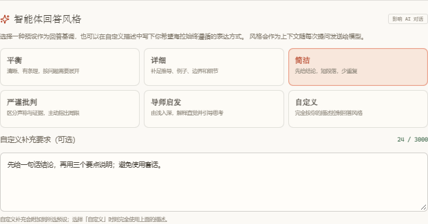

### OpenAI 联网搜索

选择 OpenAI 模型后，聊天输入框下方会出现「联网」按钮。启用后，海拉改用 OpenAI **Responses API**，并加入：

```json
{
  "tools": [{ "type": "web_search" }],
  "tool_choice": "auto"
}
```

启用后的行为：

- 论文之外的最新信息、公开事实可以联网查找
- 回答中会附带「联网来源」Markdown 链接
- 论文内部事实仍以 PDF 原文为准
- 开关偏好保存在当前浏览器，下次打开继续使用上次选择
- 普通 DeepSeek / Anthropic / 自定义兼容服务不会显示这个开关

注意：

- 需要模型和 API 网关支持 Responses API 与 `web_search` 工具
- 搜索会增加请求耗时，并可能产生 OpenAI 的搜索调用费用
- 搜索关键词会发送给 OpenAI
- 如果网关只支持 Chat Completions，会在对话中返回接口错误

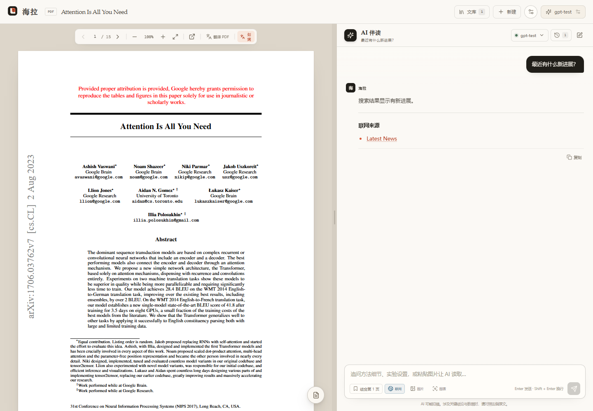

## 文献雷达（对话搜索）

在首页或文库顶部点击「搜文献」，会进入独立的「文献雷达」页面。它不是首页和文库的弹窗，而是一个完整的大模型对话界面。

使用方式：

1. 在右上角选择固定导入位置：未分类或任意文件夹/子文件夹。
2. 用自然语言描述要找的论文，例如：
   - 找近三年关于多模态推理的顶会论文
   - 找一篇适合入门的扩散模型综述
   - 找用强化学习做代码生成的论文
3. 模型返回论文标题、作者、年份/发表处、相关性说明和可验证链接。
4. 结果下方会列出可识别的 arXiv / PDF 链接：
   - 单篇「导入到「当前文件夹」」
   - 「全部导入到「当前文件夹」」
5. 导入后论文直接保存到所选文件夹，不需要先打开阅读器。

检索来源：

- **OpenAI 模型**：使用 OpenAI Responses API 的 `web_search` 工具。
- **DeepSeek / Anthropic / 自定义模型**：使用 OpenAlex 学术文献库检索真实文献，再由当前模型整理结果。
- 只有模型确认后的链接才会显示导入按钮；导入前不会自动修改文库。
- 检索结果和对话只保存在当前页面；导入的论文写入当前浏览器的 IndexedDB。

当前限制：

- OpenAI 的联网搜索需要网关支持 Responses API；不支持时会在页面报错。
- OpenAlex 是学术文献库，不等同于通用网页搜索；没有开放 PDF 的条目只能提供链接和元数据。
- 非 arXiv 且不是直接 PDF 的链接不能导入。

### 图片输入

可以直接把图片复制到聊天输入框，让智能体读取论文截图、图表或手写内容：

- 在输入框中按 `Ctrl+V` / `Cmd+V` 粘贴剪贴板图片。
- 也可以点击输入框下方的「图片」按钮选择文件，或把图片拖进输入框。
- 发送前会显示缩略图，可逐张移除。
- 一次最多 4 张，支持 PNG / JPEG / WebP。
- 单张原图不能超过 15 MB；应用会自动缩放到最长边 1600px 并压缩。
- 图片会保存在当前论文的对话历史中，重新打开论文仍然能看到；发送后也会自动进入站点图片库并获得链接。
- 没有文字只发图片时，会自动使用「请分析这张图片。」作为问题。

图片需要所选模型支持视觉输入。OpenAI 的 GPT-4o / GPT-4.1 系列、Anthropic Claude、DeepSeek 的视觉模型以及支持 `image_url` 的 OpenAI 兼容服务都可以使用；纯文本模型会由服务商返回错误。

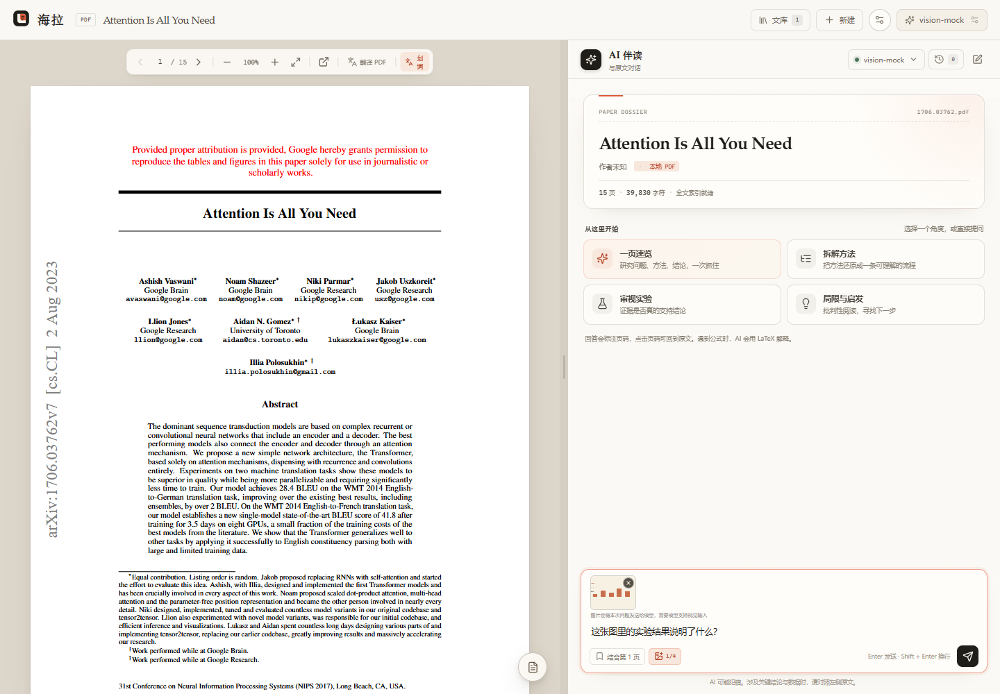

### 论文图片与图表

聊天中发送的图片会自动保存到本机站点目录 `.runtime/images`，不需要在前端单独显示图片库。后台会为每张图片生成稳定链接：

```text
http://127.0.0.1:8787/api/images/img_xxx
```

发送图片时，智能体会同时收到图片内容和站点链接，因此可以在生成或更新笔记时直接引用图片：

```markdown

```

站点图片保存在本机的 `.runtime/images`，不是浏览器 IndexedDB；当前 ZIP 数据备份只包含浏览器数据，不包含这个目录。复制站点到另一台设备时，需要单独备份 `.runtime/images`，否则笔记中的图片链接会失效。

#### 提取论文原文图表

聊天输入框下方的「图表」按钮会读取当前 PDF 页面的图片和图表标题，自动裁切当前页的 Figure / Table 区域，并作为待发送图片加入对话。点击发送后，智能体可以直接读取裁切后的图表，图片也会自动保存到后台并获得链接。

- 切到包含 Figure / Table 的页面再点击「图表」
- 裁剪结果会显示缩略图，可先移除
- 如果没有识别到标题，会退化为整页图片
- 发送后智能体会看到图表和对应链接

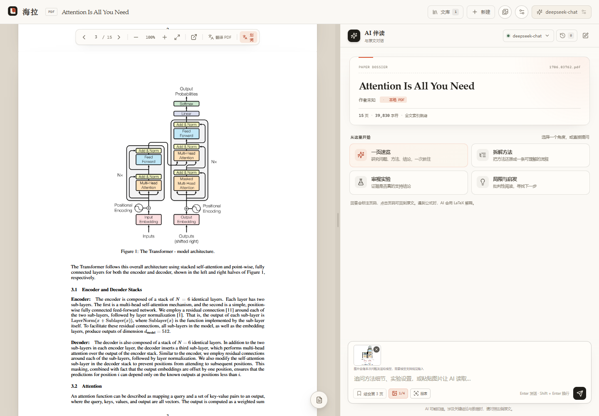

### 本地模型示例（Ollama）

在设置中选择「自定义 / 本地」：

- Base URL：`http://127.0.0.1:11434/v1`
- 模型：例如 `qwen2.5:7b`
- API Key：可留空（localhost 被识别为本地服务）

## 文库与历史对话

- 每次成功导入论文后，应用会把论文元数据、抽取文本、PDF 原件（若浏览器允许）和封面缩略图写入浏览器 **IndexedDB**。
- 点击顶部的「文库」进入管理页：搜索标题 / 作者 / 摘要 / arXiv 编号 / PDF 链接，按来源或收藏筛选。文库右上角的「批量导入」可以继续添加链接和文件。
- 排序方式：最近打开、最近添加、阅读进度（高→低 / 低→高）、标题（升序 / 降序）、发表时间（新→旧 / 旧→新）。排序对「全部文献」和任意文件夹同时生效，并可与搜索、来源筛选组合使用。
- 阅读进度按「已读页数 / 总页数」计算；没有发表时间的本地或网页 PDF 在发表时间排序中始终排在最后。
- 左侧文件夹栏支持「全部文献 / 未分类」以及自建文件夹。点「新建文件夹」创建根文件夹；悬停文件夹可新建子文件夹、重命名或删除。子文件夹默认折叠；有子文件夹的文件夹右侧显示灰色状态圆点，点击折叠/展开，或使用「展开全部 / 折叠全部」。所有文件夹左侧对齐。
- 拖动整理：把文件夹拖到另一个文件夹上，它会连同全部子文件夹变成目标文件夹的子文件夹；把论文卡片拖到文件夹上即可归类。选中多篇论文时拖动其中一篇，会一起移动选中的论文。不能把文件夹拖进自己的子文件夹。
- 把论文加入文件夹：点击卡片右上角的文件夹按钮，在弹出的列表中选择目标文件夹或「未分类」。子文件夹会显示完整路径，例如「项目 / 2026」。
- 删除文件夹时，直属论文会移动到上一级文件夹（根文件夹则到「未分类」），子文件夹会提升到上一级；论文、PDF 和对话都会保留。
- 卡片显示阅读进度、对话数量和最近打开时间。删除论文会同时删除它的 PDF 数据、阅读进度和所有对话。
- 对话保存在当前论文下。聊天标题栏的历史按钮会打开对话抽屉，其中显示该论文的所有对话；可重命名或删除。
- 文库中记录的最后阅读页码会在再次打开时恢复；最新对话也会自动载入。
- 从文库进入论文、阅读后再返回文库时，会回到之前滚动到的位置，而不是自动跳到顶部；关闭文库再打开同样保留位置。
- 所有数据只在本机浏览器，不提供账号同步。清除浏览器站点数据会清空文库；页面会显示浏览器为本站估算的本地存储占用。可以随时用「数据备份」导出 ZIP，在另一台安装海拉的设备上恢复完整状态。

### 阅读状态与归档

每篇论文都有一个手动设置的状态：

- **未读**
- **进行中**
- **已读**
- **归档**

状态只在你通过卡片上的状态下拉框选择时改变，打开论文、翻页或阅读完成都不会自动切换。新导入论文默认「未读」。

标记为「已读」后，论文会从「全部文献」和常规文件夹视图隐藏，但仍保留所属文件夹、PDF 原文、阅读笔记、对话和报告。点击阅读状态栏的「已读」可以重新查看和打开；常规视图中的文件夹数量也只统计当前可见状态。

切到「归档」时会：

- 从浏览器 IndexedDB 删除 PDF 原件
- 删除抽取全文
- 删除中文翻译 PDF
- 删除本机 `.cache/arxiv` 中的缓存 PDF
- 删除本机 pdf2zh 服务生成的对应翻译文件

只保留论文名片：标题、作者、摘要、年份、来源、arXiv / 网页链接、缩略图和对话记录。

已读论文不计入常规视图的文件夹数量和未分类数量，只出现在「已读」筛选中；归档论文进一步从文库存量、收藏数量等统计中排除，只出现在「归档」筛选中。

归档论文在「归档」视图中显示，点击卡片会打开原始 abs / 网页链接；本地 PDF 没有可打开的链接，只保留名片。把归档论文改回其他状态后，需要重新导入 PDF 才能阅读。

归档前会显示自定义确认框，明确列出「会删除」和「会保留」的内容。确认框底部的「以后不再提醒」可以关闭后续归档确认；设置后再次归档会直接执行。归档当前正在阅读的论文时会退出阅读器，但保留在文库页面，不再跳回首页。

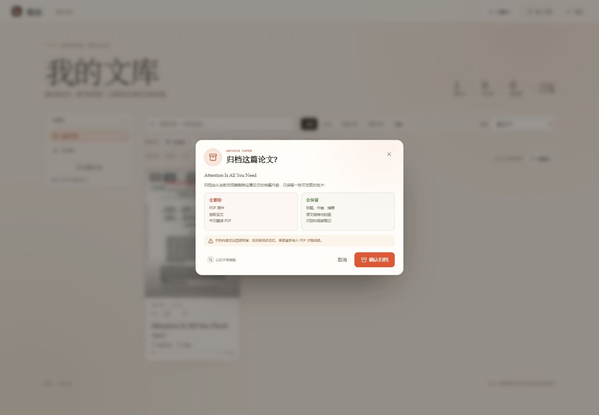

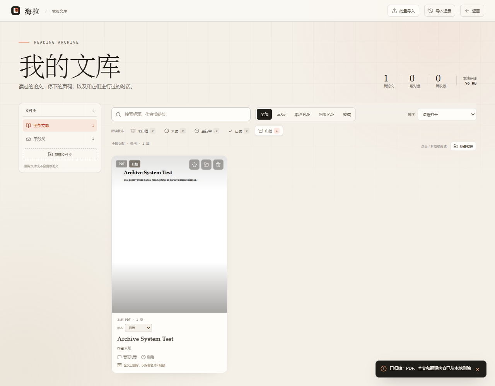

### 阅读笔记

每篇论文都有独立的 Markdown 笔记：

- 点击阅读器右下角的圆形文档按钮，在论文原文和笔记之间切换。
- 支持「编辑 / 分栏 / 预览」三种视图。
- 输入原始 Markdown，右侧实时渲染标题、列表、表格、代码和 LaTeX 公式。
- 自动保存到当前论文的浏览器 IndexedDB；切换论文或返回论文时会立即刷新保存。
- 每个论文的笔记互不影响，重新打开论文会自动恢复。

AI 对话与笔记是双向连接的：

- 每次提问会把当前笔记作为上下文发送给模型，因此可以直接问「我的笔记里还缺什么」「按笔记总结方法」。
- 明确要求「整理成笔记」「把这一段加到笔记」时，模型会在回答末尾生成完整的新笔记，客户端自动写入并显示「已更新阅读笔记」。
- 普通问答不会改动笔记；笔记只保存在当前浏览器。

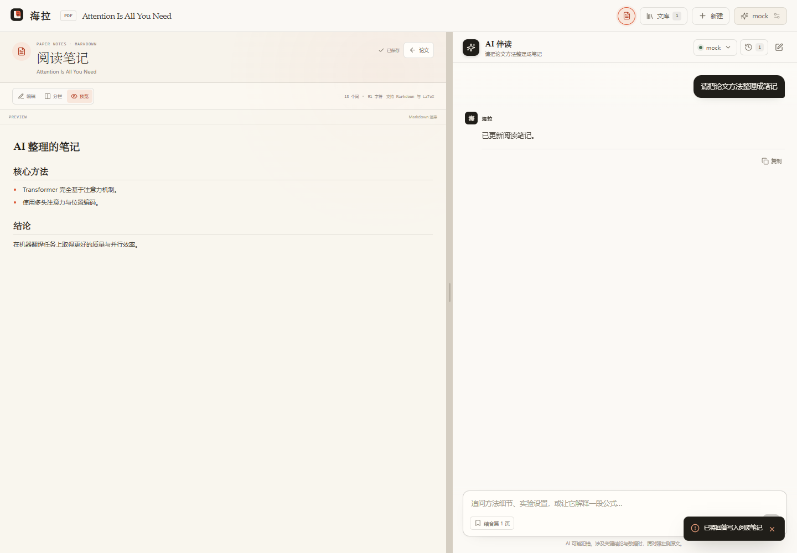

### 备份与恢复

打开「设置 → 数据备份」：

- **导出完整备份**：生成一个 ZIP 文件，包含论文元数据、PDF 原件、翻译 PDF、对话、文件夹、笔记、导入记录和模型设置。
- **从备份恢复**：选择 ZIP 后覆盖当前浏览器中的数据，并自动打开备份时正在阅读的论文；如果当时在写笔记，会直接回到笔记界面。

在新设备上：

1. 安装并启动海拉
2. 第一次启动的模型配置窗口点击「或从海拉备份恢复」
3. 选择备份 ZIP
4. 确认覆盖
5. 海拉自动恢复数据并打开上次的论文

注意事项：

- 备份包含 API Key，请像密码一样保存，不要发给他人。
- 恢复会覆盖当前浏览器中已有的海拉数据；建议先导出一份当前备份。
- PDF 和翻译文件会让备份文件较大，导出时需要等待打包完成。
- 备份是浏览器数据文件，不是云端同步；新设备仍需安装海拉并运行在 `http://127.0.0.1:8787`。

### 批量整理论文

在文库结果行右上角点击「批量整理」：

- 点击任意卡片选择或取消选择，卡片右上角会显示选中状态。
- 「全选当前」选择当前文件夹、搜索和来源筛选下的全部结果；「取消全选」或「清空」可重置。
- 底部工具栏显示已选数量，点击「移动到文件夹」选择目标文件夹或「未分类」。
- 一次操作会给所有选中论文设置同一个目标文件夹；分批选择不同论文并重复操作，就能整理到不同文件夹。
- 批量移动只修改文件夹归属，不改变 PDF、阅读进度、收藏状态或对话。
- 点击「完成」退出整理模式。

### 批量导入与 TXT 链接

点击首页或文库右上角的「批量导入」：

- **链接**：每行一个 arXiv 编号 / 链接或 PDF 直链，也可以直接粘贴多行。
- **导入 TXT**：选择 `.txt` 文件后，会按行识别 arXiv 链接、PDF 直链和 Markdown 链接；无法识别的行会被跳过，识别结果会追加到链接输入框并显示统计。
- **本地 PDF**：可多选；只在当前浏览器解析。
- **导入到文件夹**：选择一个已有文件夹后，本批导入的论文会直接写入该文件夹；如果论文已经存在，也会移动到所选文件夹。选择「不指定」则保持原文件夹，新论文进入未分类。

### 后台导入

批量导入开始后，点击底部的「后台运行」可以收起导入窗口：

- 左下角会出现一个常驻进度条，显示当前任务、整体进度和完成状态。
- 后台运行期间仍可打开文库、阅读其他论文或返回首页。
- 点击「查看进度 / 查看结果」可恢复完整导入面板。
- 导入完成时会在左下角显示成功数或失败数；失败批次仍会写入「导入记录」。
- 后台导入是**浏览器内任务**，页面必须保持打开；刷新或关闭页面会中断未完成的部分。页面会在有后台任务运行时提示确认离开。
- 已显示「已保存到文库」的论文即使之后中断也会保留。

TXT 识别规则：

- 单独一行的 URL、Markdown 链接，或行内出现的 arXiv / PDF 直链会被识别；
- 普通网页 URL 只有在整行只有一个链接时才会作为候选，最终仍由服务端校验是否为 PDF；
- 空行不计数；没有任何可识别链接的非空行会计入「跳过」；
- 重复链接会自动去重，文件最大 2 MB。

### 导入失败记录

批量导入只要出现失败或中途取消，就会自动留下记录：

- 点击文库右上角的「导入记录」查看。
- 按「今天 / 昨天 / 具体日期」分组，每条显示开始的时、分、秒。
- 每次记录包含总条目数、成功数、失败数、取消数，以及目标文件夹。
- 失败或取消的条目会显示原始链接 / 文件名和具体错误，例如 404、不是有效 PDF、不是有效链接。
- 全部成功的批次不会占用失败记录空间。
- 最多保留最近 200 次有问题的导入；「清空记录」只清历史，不会删除文库论文。
- 记录保存在当前浏览器的 IndexedDB 中，包含导入链接、文件名和错误信息。

## 划词翻译

- 在 PDF 原文上拖选文字，停顿约 0.3 秒后自动出现翻译浮层并开始请求。
- 源文本主要为英文时译为中文，主要为中文时译为英文；论文标题和当前页正文会作为术语与指代参考发送给模型。
- 翻译使用同一套模型配置。未配置模型时会提示「去配置」，配置保存后会自动继续翻译。
- 浮层支持复制译文；点击浮层外、滚动 PDF 或按 `Esc` 会关闭。
- PDF 工具栏的「划词」按钮可以临时关闭自动翻译。关闭后文字仍可选择、复制。
- 扫描版 PDF 没有文字层，无法划选，因此也不能使用划词翻译。
- 划词内容只用于本次翻译，不会写入对话历史；聊天记录仍按论文单独保存。

## 工作原理

1. 浏览器通过 PDF.js 加载 PDF，并用 `getTextContent()` 抽取每页文字，保留页码；同时把文字层铺在页面上，支持划选。
2. 服务端把正文切成约 1k–2k 字符的片段，用轻量 BM25 风格检索结合章节入口与全文覆盖采样，选出适合当前问题的片段。
3. 模型收到：系统阅读规则 + 论文元数据/摘要 + 相关正文片段 + 对话历史。
4. 回答通过 SSE 流式返回，前端实时渲染 Markdown 和公式。
5. 划词翻译单独调用 `/api/translate`，传入选中文本、当前页上下文与论文标题，只要求模型输出译文。
6. arXiv PDF 下载后会缓存到 `.cache/arxiv/` 供服务端代理使用；浏览器端会把 PDF、文本与对话另存到 IndexedDB。本地 PDF 不写入服务器。
7. 任意 PDF 直链由 `/api/pdf/fetch` 在服务端下载并校验 `%PDF` 文件头，再返回浏览器解析。该接口会阻止本机、内网和云元数据地址，限制 120 MB、超时 60 秒，并逐跳校验重定向；不把远程 PDF 持久化到服务器。批量导入按顺序复用同一流程，逐篇写入 IndexedDB。
8. 设置页的模型列表通过 `/api/models` 转发到当前 Base URL：OpenAI 兼容服务读取 `/models`，Anthropic 读取 `/v1/models`。常用模型保存在浏览器本地，切换时直接恢复对应配置。

## PDF 全文翻译（zotero-pdf2zh）

海拉可以对接 `guaguastandup/zotero-pdf2zh` 提供的本地 HTTP 服务，把整篇 PDF 翻译成中文单语版本。该仓库本身是 AGPL-3.0 的 Zotero 插件与 Python 服务，不包含 `SKILL.md`；海拉不复制其插件代码，只通过 HTTP 协议调用服务。

### 自动启动与隔离

海拉启动时会自动启动一份**项目内独立**的 pdf2zh 服务：

```text
haila/
  .runtime/
    zotero-pdf2zh/       # 固定版本的独立克隆
    pdf2zh-venv/         # 独立 Python 3.12 环境
    pdf2zh-cache/        # 独立的模型 / HuggingFace 缓存
    pdf2zh-service.log   # 服务完整日志
```

- 服务端口固定为 `8891`，不会占用本机已有 Zotero/pdf2zh 的 `8890`。
- 使用独立 venv 和缓存，不读取或修改现有 conda 环境。
- 配置文件位于独立克隆的 `server/config`；翻译输出位于其 `server/translated`。
- `.runtime/` 已加入 `.gitignore`，不会被提交到 Git。
- 海拉退出时会停止自己启动的 pdf2zh 子进程；如果 8891 上已经有服务，会直接复用。
- 启动失败不会影响海拉的阅读和聊天功能，详细原因见终端和 `.runtime/pdf2zh-service.log`。

可通过环境变量覆盖：

```text
PDF2ZH_AUTOSTART=0        # 关闭自启动
PDF2ZH_PORT=8891          # 修改端口
PDF2ZH_HOME=...           # server.py 所在目录
PDF2ZH_PYTHON=...         # 专用 Python 解释器
```

### 在海拉中配置

打开「连接 AI 模型」设置，在「PDF 全文翻译」区域填写：

- **服务地址**：默认 `http://127.0.0.1:8891`
- **翻译引擎**：`pdf2zh_next / BabelDOC` 或 `pdf2zh 1.x`
- **接口类型**：DeepSeek / OpenAI / OpenAI 兼容
- **API Base URL**：默认 `https://api.deepseek.com`
- **API Key**
- **模型名称**：默认 `deepseek-flash`

海拉会根据 API URL 自动识别 DeepSeek 和 OpenAI；其他地址自动使用
`openaicompatible`，所以只要服务兼容 OpenAI 的 `/chat/completions` 协议，
配置 API URL 和 Key 后，模型栏会自动读取该 API 可连接的模型；也可以点「刷新」重新读取，或直接手动填写模型名。

常见示例：

| 服务 | API Base URL | 模型示例 |
|---|---|---|
| DeepSeek | `https://api.deepseek.com` | `deepseek-flash` |
| OpenAI | `https://api.openai.com/v1` | `gpt-4o-mini` |
| OpenRouter | `https://openrouter.ai/api/v1` | `openai/gpt-4o-mini` |
| SiliconFlow | `https://api.siliconflow.cn/v1` | `Qwen/Qwen2.5-7B-Instruct` |
| 本地 Ollama | `http://127.0.0.1:11434/v1` | `qwen2.5:7b` |

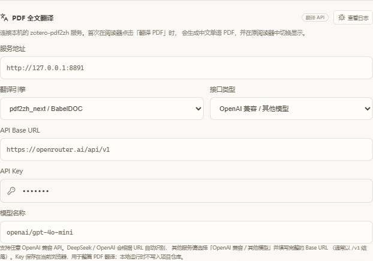

Base URL 需要包含服务要求的路径，通常以 `/v1` 结尾；模型需要支持 Chat
Completions。Key 保存在当前浏览器，并在每次翻译时通过本地代理发送给 pdf2zh；
本地运行时配置位于 `.runtime`，不会写入项目源码仓库。打开任意论文，点击 PDF
顶部的「翻译 PDF」即可。服务端网页也可以直接访问 `http://127.0.0.1:8891`。

### 使用行为

- 翻译任务在后台轮询，工具栏显示进度。
- 生成的是**中文单语** PDF；不会新增文库卡片，也不会单独打开翻译文件。
- 完成后自动切换到中文版本，工具栏出现 `EN / 中文` 切换按钮。
- 切换时保留当前阅读页码；关闭页面后，翻译 PDF 会保存在当前浏览器的 IndexedDB 中，下次打开可直接切换。
- PDF 原文会发送到你配置的本机 pdf2zh 服务；服务端会再把它发送给所选的翻译模型。翻译结果只保存在当前浏览器。
- 如果服务未启动、地址错误或服务端模型未配置，工具栏会显示失败，可点击「重试翻译」。

### PDF 翻译日志

调试 PDF 翻译时可以直接在界面中查日志：

- 打开「设置 → PDF 全文翻译 → 查看日志」。
- 翻译失败时，PDF 工具栏也会出现「日志」按钮。
- 日志面板支持：
  - `pdf2zh 服务` / `海拉启动` 两个来源
  - 搜索 `Traceback`、`error`、任务 ID 等关键词
  - 自动刷新、手动刷新
  - 复制当前结果、下载日志
  - 错误和警告行高亮
- 默认读取最近 **2 MB** 日志，避免大文件卡顿；超出时会标注「仅显示最近 2 MB」。
- 返回前会脱敏 `sk-...`、`apiKey`、`token`、`secret` 等字段，避免把 Key 粘到 Issue 中。
- 完整日志文件仍位于 `.runtime/pdf2zh-service.log` 和 `.runtime/haila-boot.log`。

### 后台 PDF 翻译

在论文里点击「翻译 PDF」后，可以直接退出当前文档：

- 返回首页、打开文库、阅读其他论文都不会中断翻译。
- 左下角显示后台翻译进度；起步时完整展示，1.5 秒后自动收起成最左侧的小圆环。
- 鼠标移到小圆环上会自动展开，移开重新收起；触屏设备点击圆环展开。
- 如果当前论文被打开，工具栏本身也会显示进度。
- 可以同时启动多篇论文的后台翻译。
- 完成后自动保存到当前浏览器；重新打开论文会直接出现 `EN / 中文` 切换。
- 后台失败时左下角显示失败原因，并可直接打开「日志」。
- 删除对应论文会取消它的后台翻译任务。

限制：这是浏览器内后台任务，**海拉页面/标签页必须保持打开**。关闭浏览器会停止轮询，
因此未保存的结果可能丢失；页面会在有后台翻译时提示确认离开。若需要关闭浏览器后
仍继续，需要把任务队列移到服务端。

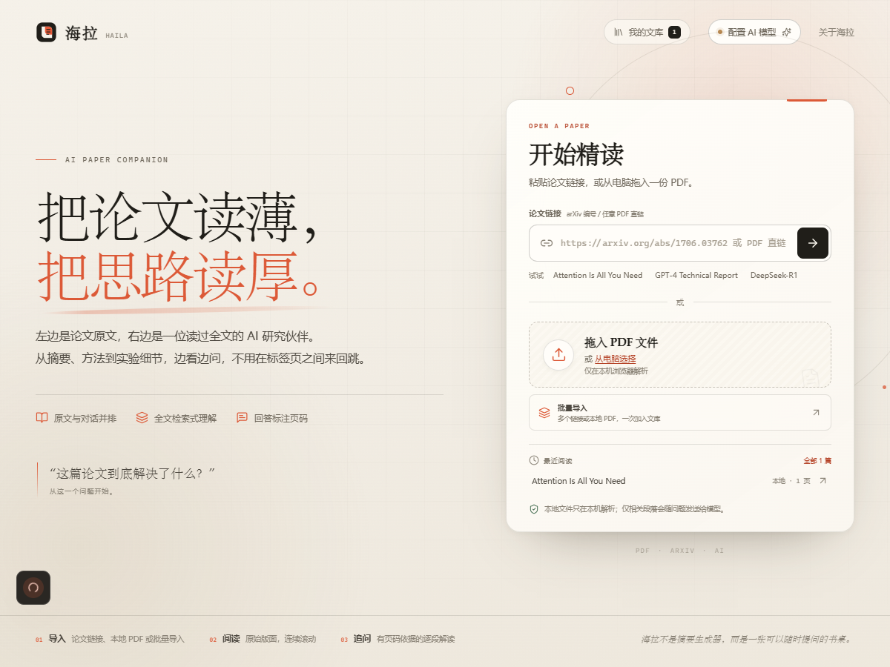

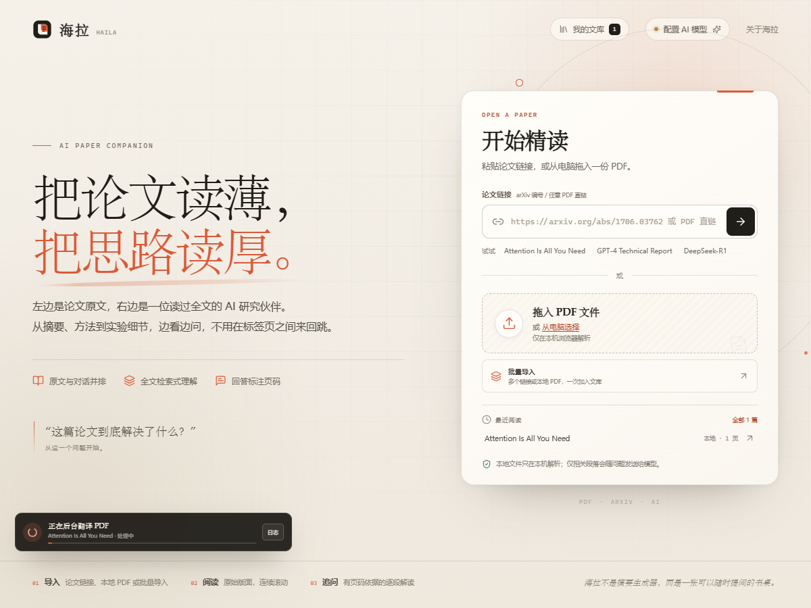

### 修复：DeepSeek 模型名 400

如果日志出现：

```text
The supported API model names are deepseek-flash, deepseek-v4-pro,
but you passed DeepSeek-V4.1-Flash-1017.
```

说明接口只接受它声明的模型名。海拉会自动把包含 `deepseek` + `flash` 的别名
归一到 `deepseek-flash`，包含 `deepseek` + `v4` / `pro` 的别名归一到
`deepseek-v4-pro`。旧浏览器配置在重新打开后会自动迁移。

也可以在「PDF 全文翻译」里手动填写：

```text
deepseek-flash
```

或：

```text
deepseek-v4-pro
```

## 项目结构

```
src/
  App.tsx                    应用状态、导入流程、对话流
  components/
    Landing.tsx              首页与导入
    BatchImportModal.tsx     批量链接 / 本地文件导入
    ImportHistoryModal.tsx   导入失败记录查看
    PdfViewer.tsx            PDF.js 连续阅读器
    PaperNotes.tsx           Markdown 笔记编辑、分栏和预览
    ChatPanel.tsx            对话、快捷动作、输入区
    MarkdownMessage.tsx      Markdown / 表格 / KaTeX
    DeepSeekSetupModal.tsx   无模型配置时显示翻译 API 首次配置
    PdfTranslationLogsModal.tsx PDF 翻译日志查询、搜索与下载
    SettingsModal.tsx        模型配置、翻译 API 配置
    LiteratureSearchPage.tsx 文献雷达：对话搜索、结果确认与导入
    LibraryModal.tsx         本地文库管理
    ArchiveConfirmModal.tsx  归档确认与不再提醒偏好
    HistoryDrawer.tsx        单篇论文的对话历史
    TranslationPopover.tsx   划词翻译浮层
  lib/
    pdf.ts                   PDF 加载、文本抽取、标题识别、缩略图
    batchImport.ts           单篇 / 批量导入流水线
    linkText.ts              TXT 链接识别与逐行过滤
    paperId.ts               arXiv / 本地 / 网页 PDF 的稳定 ID
    api.ts                   arXiv、PDF 代理与聊天 SSE 客户端
    config.ts                当前模型配置与持久化
    modelProfiles.ts         常用模型配置的保存、切换与删除
    pdfTranslation.ts        pdf2zh 服务配置、提交、轮询与结果下载
    backup.ts                ZIP 完整备份、恢复与旧数据迁移
    imageAttachment.ts       聊天图片校验、缩放和压缩
    pdfFigures.ts            论文当前页图表识别与裁切
    library.ts               IndexedDB 论文 / PDF / 对话 / 翻译 / 笔记 / 导入记录存储
scripts/
  deploy.mjs                一键部署：预检、依赖、可选 pdf2zh、构建、API、验证
  doctor.mjs                环境预检：Node、npm、Git、磁盘、代理、运行时
  verify.mjs                临时启动服务做 HTTP 冒烟验证
  test-gateway.mjs          使用 /models 测试模型网关连通性
  configure-api.mjs         命令行写入 DeepSeek API Key 与模型配置
  setup-api-ui.ps1          Windows 图形界面 API 配置
  setup-api-console.ps1     打开独立命令行窗口配置 API
  setup-api-prompt.ps1      命令行配置窗口的内层脚本
  setup-pdf2zh.mjs          创建独立 pdf2zh 克隆、Python 环境和配置
  upgrade.mjs               一键升级：git pull、依赖、运行时、构建、验证
  start-haila.ps1           后台启动海拉、等待就绪并打开浏览器
  start-haila.cmd           cmd 包装器，供桌面快捷方式调用
  install-haila-shortcut.ps1 创建桌面快捷方式
server/
  start.mjs                  读取 .env、代理环境后启动服务
  index.mjs                  Express API、静态站点、SSE
  arxiv.mjs                  arXiv 校验、元数据、PDF 缓存
  pdf-proxy.mjs              任意 PDF 直链下载、SSRF 防护
  pdf2zh.mjs                 pdf2zh 服务代理：提交、任务查询、翻译 PDF 下载
  pdf2zh-autostart.mjs       启动/复用独立的本地 pdf2zh 服务
  images.mjs                 站点图片存储、列表、删除与静态服务
  context.mjs                文本分块、检索、提示词
  providers.mjs              OpenAI 兼容 / Anthropic 流式适配、模型列表
public/pdfjs/                PDF.js 的 cmaps、字体、wasm 资源
```

## 隐私与边界

- 正常阅读时，本地 PDF 文件不会上传到远端；它和抽取文本、对话历史一起保存在当前浏览器的 IndexedDB 中。提问时会把解析后的相关文本片段随问题发送给你配置的模型；如果粘贴了图片，图片也会一起发送给支持视觉输入的模型。划词翻译时会发送选中文本、当前页上下文和论文标题。
- 使用 PDF 全文翻译时，原始 PDF 会发送到你填写的 pdf2zh 服务地址；如果该地址不是本机，文件会离开这台电脑。翻译后的 PDF 保存在当前浏览器，删除论文或归档时会一并删除。归档还会清理本机 arXiv 缓存和本机 pdf2zh 生成的对应文件；外部 pdf2zh 服务自己的缓存不在这台电脑的管理范围内。
- 任意 PDF 直链由本机服务下载，下载后的 PDF 与本地文件一样只保存在浏览器 IndexedDB；原始链接会随论文记录保存在浏览器中。服务端不会长期保留远程 PDF。
- 模型 API Key 默认保存在浏览器；若使用 `.env` 配置服务器 Key，则 Key 只在本地服务进程中。PDF 全文翻译的 API Key 保存在浏览器，并由 `.runtime` 内独立 pdf2zh 运行时使用；`.runtime` 不会提交到 Git。
- 「常用模型」会把名称、Base URL、模型名称和 API Key 一起保存在当前浏览器的 `localStorage`。读取模型列表时，Key 由本地服务转发给所选网关，但不会写入磁盘；清除站点数据会删除常用配置。
- 阅读笔记保存在浏览器 IndexedDB。向论文提问时，当前笔记会作为上下文一起发送给你配置的模型；普通问答不会修改笔记，只有 AI 明确输出笔记更新块时才会自动保存。
- 导入失败记录保存在浏览器 IndexedDB，包含失败的 PDF 链接、本地文件名和错误信息，最多 200 次；可以在记录窗口清空，不影响论文。
- 文库没有云同步，换浏览器或清除站点数据后不会保留；如需迁移，请先导出原始 PDF。
- 扫描版 PDF 没有 OCR。能阅读原文，但 AI 可依据的文字很少，界面会提示。
- PDF 文本层可能有乱序、断词或公式丢失，回答时模型会尽量结合上下文修复，但仍建议核对原文。
- 本项目面向本地/个人使用：没有用户系统、鉴权、限流和多租户隔离。**不要直接暴露到公网**而不加保护。
- 公开部署时还要注意 arXiv 的使用条款与请求频率；缓存已减少重复下载。

## 常见问题

**提问后提示「请先配置 AI 模型 API Key」？**  
点击右上角模型按钮，填入 Key；或按上面的方式配置 `.env`。

**arXiv 打不开？**  
链接支持 `https://arxiv.org/abs/...`、`https://arxiv.org/pdf/...`、`https://arxiv.org/pdf/....pdf` 以及带版本号的链接，也可以直接粘贴编号。元数据和 PDF 都配置了备用地址；如果全部失败，界面会给出提示，也可以先把 PDF 下载到本地再拖入。偶尔遇到 arXiv 访问限制时，稍后重试通常即可。

**任何 PDF 链接都能导入吗？**

需要是直接返回 PDF 文件的 `http/https` 链接。普通网页、需要登录/Cookie 的下载页、返回 HTML 的跳转页会失败；单份文件上限 120 MB。出于安全原因，本机地址、局域网地址和云元数据地址会被拒绝。如果链接会触发下载而不是直接返回文件，建议先下载到本地，再用批量导入选择文件。

**批量导入时关闭页面会怎样？**

已经显示「已保存到文库」的论文会保留；正在下载/解析的那一篇可能中断。重新打开页面后可以在文库中确认，未完成的项目重新导入即可。重复导入同一篇 arXiv 论文、同一份本地文件或同一个 PDF 链接会更新原记录，不会产生重复卡片。

**TXT 里有些行没有被识别？**

TXT 按行处理，无法识别的行会跳过。请确保 arXiv 链接 / PDF 直链所在行没有多余字符，或者把链接单独放在一行；普通网页 URL 只有整行仅包含该链接时才会进入候选。TXT 文件上限 2 MB。

**模型报 404 / 401？**  
检查设置里的 Base URL 与模型名是否匹配。OpenAI 兼容接口的 Base URL 通常要带 `/v1`（例如 `https://api.openai.com/v1`）。

**「获取列表」失败或列表为空？**

先确认 Base URL 能在浏览器外访问，并且服务商开放了 `/models`。部分网关只提供 Chat Completions、不允许列出模型，或需要额外的组织/项目请求头；这种情况直接手动填写模型名称即可。OpenAI 兼容网关通常要求 Base URL 带 `/v1`。

**提示「无法连接模型网关：fetch failed」？**

这是本地服务的出站网络问题，不是模型名错误。官方 OpenAI 在当前网络通常需要代理：浏览器的系统代理不会自动传给 Node.js。按上面的「通过本地代理访问 OpenAI」在 `.env` 配置代理后重新执行 `npm start`。可以用一个无效 Key 测试 `/api/models`：如果返回 401（而不是超时/502），说明网络已经连通，只需换成有效 Key。

**回答太长或模型上下文超限？**  
可在 `.env` 调整 `MAX_CONTEXT_CHARS`（默认 46000，范围 9000–120000）。数值越小，发送的片段越少。

**文库数据存在哪里？浏览器空间不足怎么办？**  
存在当前浏览器的 IndexedDB。空间不足时应用会优先保住论文信息、文本与对话；如果 PDF 原件保存失败，卡片会标记「缺少文件」，重新导入原文件即可恢复。清除浏览器站点数据会删除整个文库和文件夹。

**删除文件夹会删除论文吗？**  
不会。删除文件夹时，子文件夹会提升到上一级，直属论文会移动到上一级或「未分类」；PDF、阅读进度和对话都保留。

**想删除某篇论文或某段对话？**  
在文库卡片右上角删除整篇论文；在聊天历史抽屉里删除单段对话。删除论文会同时删除其 PDF、进度和全部对话。

**划选文字没有出现翻译浮层？**  
先确认 PDF 中能选中文字（扫描件没有文字层，无法划词）；再确认工具栏的「划词」按钮处于高亮开启状态。若浮层提示配置模型，按提示填入 API Key 后会自动重试。

## 说明

项目已用真实的 arXiv 论文、网页 PDF 直链和本地 PDF 做浏览器端验证，并使用本地 mock 模型验证了流式对话、错误提示、重试、页码跳转、当前页上下文、停止生成、文库持久化、对话历史、文件夹创建/子文件夹/多级筛选/移动/重命名/删除与旧版 IndexedDB 迁移、任意 PDF 直链、批量链接/文件混合导入、TXT 链接识别、目标文件夹导入、批量整理论文到不同文件夹、按进度/标题/发表时间正倒序排序、后台导入跨页面运行与恢复、导入失败记录与跨刷新持久化、多文件拖入、来源筛选、模型列表读取、常用模型保存/切换/删除、划词翻译、翻译请求取消/关闭、pdf2zh 代理协议与中文单语 PDF 同页切换、独立 pdf2zh 服务自启动与隔离，以及真实 pdf2zh_next + DeepSeek 的单页 PDF 端到端翻译。真实第三方模型的对话与划词翻译仍需在界面中配置你自己的 API Key。
